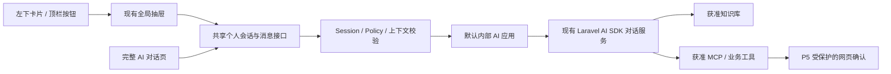

# 全站 AI 助手设计与接入规划

版本：v1.7 · 日期：2026-11-18 · 状态：设计与交互示意，尚未实施。

总方案见 [AI-DESIGN.md](AI-DESIGN.md)，阶段任务见 [AI-ROADMAP.md](AI-ROADMAP.md)。本文件补充全站助手的入口、上下文与操作流程，沿用总方案的认证、知识库、MCP 和 RabbitMQ 规则。

## 1. 产品定位与已确定的选择

用户已选择：**全站右侧聊天抽屉，可随时展开**。截图中的左下卡片作为入口样式参考；“任务协助”是目标能力，不代表当前已有任务、项目或其他业务系统。

助手使用一个默认的内部 AI 应用，与完整 AI 对话页共用应用配置、个人会话、消息、模型、知识库和工具。管理员维护该应用的提示词与资源；成员在当前页面即可提问，不必先跳转聊天页。

首版在 `serve/config/ai.php` 中通过 `AI_ASSISTANT_APP_ID` 指定默认应用。由管理员创建内部应用后配置其 ID；不新增助手配置表或设置中心。应用必须为内部、已启用且当前成员有权使用；无可用应用时显示明确的不可用状态。

### 已有代码与复用决定

| 已核对的位置 | 现状 | 接入决定 |
| --- | --- | --- |
| `admin/src/components/core/layouts/art-chat-window/index.vue` | 已有全局 ElDrawer，桌面 480px，640px 以下全宽；当前是假消息 | 直接改成 AI 助手，复用抽屉和文本气泡 |
| `admin/src/config/modules/component.ts` | `chat-window` 已启用并异步注册 | 保留一份全局注册，更新名称；不再挂第二个助手 |
| `admin/src/views/index/index.vue`、`art-global-component` | 助手可挂在后台布局的全局组件区域 | 不放进每个业务页面，登录页和匿名分享不挂载 |
| `art-header-bar/index.vue`、`mittBus.ts` | 已有顶栏入口和 `openChat: void` 事件 | 顶栏与左下卡片共用这个打开事件 |
| `art-sidebar-menu/index.vue` | 支持左侧、双列、折叠和移动菜单 | 左侧有空间时显示入口卡片；折叠显示图标；无侧栏时使用顶栏入口 |
| `admin/src/views/template/chat/index.vue` | 完整聊天演示页也监听 `openChat`，未在卸载时解绑 | 迁移 AI 对话布局时去掉该监听；示例页若保留，也移除这份全局监听 |
| `admin/src/store/modules/user.ts` | user store 持久化，已有 `isLock` 与注销流程 | 助手另用不持久化的会话状态，注销、换账号、锁屏时清理 |

第一版继续用现有 Element Plus，不增加聊天组件库、Agent 编排平台、WebSocket 或独立助手服务。

## 2. 入口与抽屉布局

### 常驻入口

- 左侧菜单底部显示“工坊 AI 助手 / 智能问答、任务协助 / 立即体验”。名称取默认应用名称，截图文案可作为初始值。
- 卡片位于菜单滚动区之外，菜单高度扣除卡片区域，避免长菜单覆盖入口；双列菜单同时保留其折叠按钮。
- 折叠状态显示带可访问名称的助手图标，展开后恢复卡片；顶部菜单或移动端依靠顶栏 AI 按钮，保证后台各页可打开。
- 页面加载时不自动弹出。没有授权时不展示可用入口；默认应用未配置或停用时，已有入口显示原因并禁止发送。
- “全站”限定已登录的企业后台。公开分享沿用独立页面和公开权限，不获得内部助手或后台页面上下文。

### 抽屉

```text
┌─────────────────────────────────────────────┐
│ 工坊 AI 助手              新对话 / 完整页 / 关闭 │
├─────────────────────────────────────────────┤
│ 本次页面：知识库 · 资料管理      使用上下文 □    │
├─────────────────────────────────────────────┤
│ 开场白与当前可用的快捷问题                       │
│ 用户问题 / AI 增量回复                          │
│ 资料来源 / 业务结果 / 待确认操作                 │
├─────────────────────────────────────────────┤
│ 多行输入                                      │
│ Enter 发送 · Shift+Enter 换行       发送 / 停止 │
└─────────────────────────────────────────────┘
```

桌面首版沿用 **480px 模态抽屉**；640px 以下满宽。模态打开时焦点留在助手内，关闭后恢复到入口，用户关闭抽屉即可继续操作页面。背景可同时点击的固定侧栏不在首版承诺范围；需要时再结合实际 Element Plus 锁定版本评估。

标题、正文、输入区有明确层级；暗色主题沿用现有主题。移动端适配软键盘，输入框和发送按钮不被遮挡。

### 消息展示

| 内容 | 展示与来源 |
| --- | --- |
| 普通回复 | 受限 Markdown 子集（列表、代码块、表格等），规则见总方案第 3 节；不执行模型 HTML，不展示内部推理过程 |
| 知识来源 | 文件名、章节/页码/行号和授权预览，来自实际检索结果 |
| 业务查询 | 实际记录的必要字段、查询范围与时间；提供受控详情入口 |
| 工具状态 | 正在查询、完成、失败；不能把失败或示例结果标为成功 |
| 操作草稿 | 操作类型、目标、字段、影响、有效期及明确的确认/取消按钮 |
| 操作结果 | 成功记录与详情入口；失败原因；结果不明时显示“待核实” |

每个会话同一时间只生成一条回复。快捷问题只在对应能力真实可用时出现；没有业务接口时不显示“查询我的任务”等可执行承诺。

## 3. 能力按已有阶段接入

| 能力 | 用户例子 | 接入方式 | 阶段 |
| --- | --- | --- | --- |
| AI 对话与页面指引 | “这个页面怎么用？”“如何创建 AI 应用？” | 默认内部应用 + 已实现页面的简短指引 + 同一 SSE 接口 | P1 |
| 企业资料问答 | “请假流程是什么？” | 获准知识库检索，附真实来源 | P2 |
| 已批准的外部工具 | “用已接入工具查询……” | 沿用应用 MCP 白名单与当前用户身份 | P3 |
| 业务查询与总结 | “我本周有哪些日程？”“总结这个客户的跟进” | 实际业务 API / Service，逐对象授权、分页和字段限制 | P5 |
| 草拟内容 | “帮我写一份汇报草稿” | 纯文本生成可在 P1 使用；保存为业务草稿要等对应接口 | P1 / P5 |
| 业务新增、修改或提交 | “把这条日程加入我的日历” | 持久操作草稿 → 用户按钮确认 → 原业务校验 → 幂等执行 | P5 |

“能回答”与“能替用户操作”分别验收。新建任务、审批、考勤等能力只有在真实系统已接入后才启用；不为助手提前创建这些业务模块。业务类型为通用定义，文中的日程、客户等只是示例；助手的业务卡片、草稿和导航按总方案第 6 节的通用业务工具契约实现，各业务注册后自动可用。

## 4. 当前页面上下文

### 首版最小上下文

默认对已接入页面启用“使用页面上下文”，发送前可关闭。上下文条展示本次将使用的页面和对象；未知页面显示“未关联页面”，继续作为普通 AI 对话。

客户端按明确的路由白名单收集以下信息，不自动抓取 DOM：

| 信息 | 允许范围 |
| --- | --- |
| 页面 | 路由名称和系统内已登记的页面标识；显示名称由系统映射 |
| 当前对象 | 后续业务详情页的资源类型和 ID，必须重新授权读取 |
| 列表筛选 | 每个已接入页面明确允许的状态、日期等必要筛选，带长度和数量上限 |
| 用户选择的材料 | 只有用户明确选择且已授权的资源标识；首版不做选中文本自动采集 |

不自动发送页面全部正文、整张列表、完整 URL/query、未提交表单、密码、API Key、附件或 iframe 内容。无上下文表示本轮不新增页面信息，不会删除用户已有的聊天历史。

### 请求示例

以下路由名称只说明字段形态，实施时使用实际注册名称：

```json
{
  "content": "这个页面怎样上传资料？",
  "client_message_id": "浏览器生成的 UUID",
  "page_context": {
    "route_name": "AiKnowledge",
    "resource": null,
    "filters": {}
  }
}
```

后续业务详情页可传 `resource: { "type": "schedule", "id": 42 }`。关闭上下文时省略 `page_context`，不发送整套页面快照。

服务端处理：

1. 根据 Session 获取成员，检查默认应用使用权和会话所有权。
2. 校验路由与字段白名单、类型、长度、允许的筛选及资源组合；忽略客户端自报的角色和权限。
3. P1 仅提供已实现页面的静态操作指引；P5 再按当前用户权限读取该业务对象的必要字段。
4. 将规范化后的上下文固定在本次用户消息上，并在 `meta` 中返回实际使用的页面/对象摘要。
5. 模型通过应用已获准的工具继续查询；每次调用重新验证用户、对象和数据范围。

页面文本、检索片段、工具返回值只作为资料，不能修改系统指令或授权。历史页面标记不能替代当前上下文；涉及“当前这条”而无法确定对象时，先要求明确对象。页面对象读取与工具查询返回服务端可重验的资源范围，纳入该轮及其后续回复的历史资源依赖，沿用总方案第 4 节的当前权限规则。

## 5. 会话与生命周期

抽屉和 `/ai/chat` 共用一个不持久化的 `ai-chat` Pinia store：当前用户/应用/会话 ID、本次 `client_message_id`、消息、输入、生成状态和 AbortController。消息持久记录仍在 MySQL，不将企业正文放入 user store 或 localStorage；锁 owner 仅留在服务端。

| 动作 | 规则 |
| --- | --- |
| 首次打开 | 读取默认助手是否可用；按用户和默认应用查询最近会话与消息；没有历史先显示开场白，首次发送先创建会话，取得会话 ID 后再发本轮流 |
| 收起再展开 | 保留当前会话；重新检查服务端状态；不自动重新生成答案 |
| 新对话 | 清空本地输入与当前会话选择；下一次发送再创建，已有历史继续保留 |
| 生成过程中切页 | 当前轮固定原页面；后续发送取新页面；每条消息保留自己的页面标记 |
| 停止或关闭抽屉 | 中止浏览器流，尽力通知/触发上游取消；保留部分文本；服务端结果未确认时显示“状态待核实” |
| 断网或刷新 | 未收到首个 `meta` 也按会话 / `client_message_id` 查询；刷新后从个人会话与消息恢复请求 ID。查询为空但 `conversation_busy` 时显示“状态待核实”；仍在生成时禁止新提交，同一请求不产生第二次调用 |
| 转完整聊天页 | 使用 `/ai/chat?conversation_id=<id>`；先收起抽屉；生成中先停止接收并恢复状态，不新建会话或再发问题 |
| 注销、换账号、锁屏 | 立即关闭、停止接收并清理本地正文/上下文/输入；解锁后按当前身份重新拉取个人历史 |
| 应用停用或权限收回 | 停止新调用，清理失权正文 / 来源 / 卡片，并重新拉取获准历史；服务端执行工具、输出及再次组装历史时复核；已发出的内容无法撤回 |

服务端的消息状态、会话锁、断开即停止和未完成回复的回收规则，见总方案第 8 节“生成的服务端生命周期”。浏览器中止不等于供应商已停止计费。服务器最终状态与会话互斥决定是否允许下一轮；180 秒单轮上限沿用总方案，在 P1 联调时校准。

消息查询同时返回本轮状态与会话是否仍忙；终态回复不代表另一轮已结束。已存在的请求由流接口返回已有状态 JSON，共享流工具识别响应类型后进入恢复流程。没有记录且会话不忙时才允许用户手动按原请求 ID 重试；旧回复按锁 owner 回收，不能仅凭“会话里有锁”认为旧轮仍在生成。

完整对话页与抽屉在同一浏览器内共享生成状态；其他标签页由后端会话互斥处理。401 沿用退出流程；419 不自动重发生成请求。

## 6. 后端与协议增量

### 复用链路



问答、问题向量和短只读工具继续在请求内通过 SSE 返回；文档解析、Embedding、索引继续走原 RabbitMQ 三队列。真正的长业务任务在对应业务模块另行评估，不把所有助手消息改为 MQ 任务。

### 接口

| 接口 | 用途 | 阶段 |
| --- | --- | --- |
| `GET /api/ai/assistant` | 默认内部应用的可用状态、获准名称/开场白和实际能力；不返回系统提示词、Key 或无权应用详情 | P1 新增 |
| `GET /api/ai/conversations?app_id=...` | 当前用户的应用会话，复用个人历史 | P1 已规划 |
| `POST /api/ai/conversations` | 为获准应用创建个人会话 | P1 已规划 |
| `GET /api/ai/conversations/{id}/messages` | 历史与状态恢复；支持 `client_message_id` 过滤及 `conversation_busy`，首个 `meta` 前断线也可查询 | P1 已规划 |
| `POST /api/ai/conversations/{id}/messages/stream` | 同一 POST SSE，增加可选白名单页面上下文 | P1 已规划 |
| `GET /api/ai/tool-calls/{id}` | 本人操作草稿与结果状态；重新检查应用和对象权限 | P5 |
| `POST /api/ai/tool-calls/{id}/confirm` | Session + CSRF 人工确认，只提交操作记录 ID，不接收替换执行参数 | P5 |
| `POST /api/ai/tool-calls/{id}/cancel` | 取消本人尚未执行的操作草稿 | P5 |

`GET /api/ai/assistant` 无可用应用时返回 `available: false` 与面向该用户的原因。可用能力由应用资源和当前权限计算；前端快捷问题据此显示，执行时仍重新鉴权。首版只有默认应用，切换其他应用在完整聊天页完成。

不增加第二个聊天流接口。沿用 `meta / delta / sources / tool / confirmation / done / error`；`meta` 补充规范化的页面摘要，`tool` 和 `confirmation` 只携带服务器已校验的展示字段。来源和业务卡片不能由模型凭空构造。

### 数据增量

- P1：复用总方案的 `client_message_id`、回复关联和服务端 `lock_owner`；`ai_messages` 添加可空的 `page_context` JSON，记录经过校验的页面/资源标识与必要筛选；完整对象正文按权限查询，不保存前端页面副本。
- P2 / P3 / P5：共用 `ai_messages.context_resources`，记录实际输入及历史继承的知识 / 工具 / 业务依赖。历史接口按当前权限返回获准回复或“相关资料已不可用”占位；失权整轮不进入下一轮模型上下文，原记录保留。
- P5：沿用 `ai_tool_calls` 保存操作草稿，按实际业务添加服务/工具 ID、规范化参数、参数摘要、有效期、确认人/时间、幂等键与结果引用。必要的敏感参数加密，审计使用独立的脱敏参数。
- 业务结果需要历史卡片时，仅保存必要的授权结果快照或结果引用；再次显示历史正文 / 卡片、打开详情 / 来源和组装模型历史时均验证当前权限，无法重验资源范围的结果不进入后续模型历史。
- 不新增助手会话表、助手用户表、独立知识库或通用工作流表；P5 字段只在业务接入时迁移。

## 7. 业务协助与确认

### 查询

“我本周有哪些日程？”由工具按当前用户、明确日期范围和分页上限查询。模型可总结获准结果，不能越过本人/对象范围。列表卡片显示实际查询范围，详情入口只使用受控站内路由。

站内导航由系统白名单映射路由名称与合法参数，结合菜单及对象权限检查；拒绝模型任意 URL、`javascript:`、外链和未知路由。未接入模块不提供假的详情按钮。

### 写入

```text
问题 → 模型提出操作 → 后端校验并保存草稿
→ 展示字段、目标与影响 → 当前用户点击确认
→ 重新鉴权与业务状态校验 → 幂等执行 → 返回真实结果
```

例如：“安排周五 15:00 的产品讨论”。助手先确定日期、时区、时长、参与人，再展示草稿；缺字段时不创建记录。确认后才调用实际日程接口。

- 聊天文本“可以”、模型工具调用、页面切换都不能触发确认。确认只能由登录网页的明确按钮经受保护接口提交。
- 草稿绑定请求人、会话、应用、工具、固定参数摘要和有效期，默认 10 分钟。页面变了仍显示原目标；编辑参数后生成新草稿并使旧草稿失效。
- 确认时重新查询用户/应用/工具权限、目标状态及所有业务规则；前端禁用按钮不能代替后端校验。
- 通过事务和唯一幂等键取得执行权，重复确认返回同一个操作状态。原业务接口不支持幂等时，暂不开放写入。
- 执行后返回原业务记录引用，并使用该页面现有刷新方式更新列表；模型的“成功”文字不作为操作成功依据。
- 超时结果不明标记“待核实”，查询原业务结果后再决定状态；不通过模型、RabbitMQ 或自动重试重复执行。
- 外部 MCP 客户端最多产生草稿和企业网页确认入口，不能自行完成确认；匿名分享不提供业务写入。

## 8. 实施必须覆盖的位置

以下是未来接入范围，本轮不修改这些业务代码。

| 位置 | 必要工作 |
| --- | --- |
| `art-chat-window/index.vue` | 删除假消息/在线状态与未支持附件按钮；接共享会话、SSE、上下文条、来源和停止状态 |
| `art-sidebar-menu/index.vue` 及样式 | 底部入口；菜单可用高度；折叠、双列、移动和无侧栏布局 |
| `art-header-bar/index.vue`、`config/modules/headerBar.ts`、i18n | 顶栏聊天入口改为 AI 助手语义与权限状态，保留统一打开事件 |
| `config/modules/component.ts`、`art-global-component` | 更新现有组件名称，确认后台只挂一份 |
| `utils/sys/mittBus.ts`、`views/template/chat/index.vue` | `openChat` 只由全局助手监听，消除演示页的第二份监听 |
| `views/ai/chat/` | 完整聊天页与抽屉共用会话 ID 和生成状态，保留应用选择/个人历史 |
| `store/modules/ai-chat.ts` | 新增必要的不持久化状态、本次客户端请求 ID、停止 / 恢复和失权内容清理，不另建消息数据层 |
| `store/modules/user.ts`、`art-screen-lock/index.vue` | 接注销、身份变化和 `isLock` 清理；助手不能覆盖锁屏 |
| `api/ai/`、`types/api/ai.d.ts`、`utils/ai-stream.ts` | 共享接口与事件类型，保持 Cookie / CSRF，处理拆包、取消、非流错误、已有状态 JSON 与按客户端请求 ID 查询恢复 |
| `utils/ai-context.ts`、实际业务路由 | 小型白名单解析；只在真实模块接入时添加其路由和参数 |
| `serve/config/ai.php`、环境示例、AI Controller / FormRequest / Policy / Service | 默认应用、上下文校验、会话授权和工具范围；不另写 Agent 编排层 |
| P1 / P2 / P3 / P5 迁移与检查 | 页面上下文、共用锁归属与恢复；历史资源依赖及当前权限过滤；后续固定草稿、幂等和结果恢复；与共享接口一起验收 |

## 9. 增量工作量与验收

相对 v1.1 的既有方案，**助手入口与共用聊天增加约 2–3 个开发日**，合并到 P1；知识与 MCP 在原阶段复用，业务模块接入另行评估。

| 增量 | 参考时间 | 可评审结果 |
| --- | --- | --- |
| 全局抽屉、两入口、共享会话、完整页衔接 | 1–1.5 日 | 真实对话可在后台各页展开 |
| 白名单页面指引、停止/恢复、身份清理和适配 | 1–1.5 日 | 上下文可见，边界状态正确 |
| 知识问答与实际工具展示 | 纳入 P2 / P3 | 同一助手可查获准资料与工具 |
| 首个业务查询和写入 | P5 按实际接口评估 | 真实查询；确认后最多产生一次业务效果 |

各阶段工作量以路线图为准：v1.6 起 P1 拆为 P1a（完整聊天页）、P1b（全站助手，本文件的内容属于这一段）和 P1c（内部上线）。估算依赖模型、MySQL、RabbitMQ 与部署环境可用，不承诺未经联调的交付日期。

### 验收清单

- [ ] 左下与顶栏打开同一个窗口；左侧、双列、折叠菜单、顶部菜单和移动端均有可达入口。
- [ ] 在完整聊天页点击入口不打开第二份演示聊天；反复进出页面不积累监听。
- [ ] 当前应用与成员身份正确，切换应用/账号不串会话；消息不写入 localStorage。
- [ ] 上下文条与该轮实际使用的上下文一致；切页不改旧轮目标；关闭上下文不再传页面信息。
- [ ] 伪造页面、对象 ID 和筛选不能越权；DOM、未提交表单与 URL 敏感字段不被自动发送。
- [ ] Enter、Shift+Enter、中文输入法、停止、Esc、焦点恢复和移动软键盘可用；有可访问按钮名称。
- [ ] 停止、关闭、断网、刷新与转完整页不重复生成；未收到 `done` 不误标完成。
- [ ] 首个 `meta` 前断线可按客户端请求 ID 恢复；消息未入库但会话仍忙时不重发；旧轮锁过期且新轮已开始时，正确区分两轮状态并禁止并发提交。
- [ ] 注销、锁屏、应用停用、成员撤权和 401 后停止接收并正确清理/恢复。
- [ ] 来源与业务结果来自真实服务；历史卡片、导航、文件和详情均验证当前权限。
- [ ] P2 / P3 / P5：知识库、工具或业务对象失权后，相关历史正文 / 卡片及包含其内容的后续回复显示占位，并从模型历史排除；原记录保留，无可重验范围的结果不进入后续模型历史。
- [ ] P5：文本确认不执行；跨用户、过期、参数变更、权限收回及状态冲突正确拒绝。
- [ ] P5：重复按钮确认不产生第二条业务记录；结果不明不自动重试；取消草稿不执行。
- [ ] 接入时运行受影响文件的类型/构建检查，以及共享 SSE、上下文授权、会话恢复和业务幂等的必要检查。

## 10. 本轮交付与限制

v1.7 同步本轮修正：首个 `meta` 前恢复、已有状态 JSON、锁归属及会话忙状态沿用共用接口；历史资料按当前权限显示和使用，相关回复继承资源依赖。首次管理员、PHP 基线、Session 时序和检索补召回见总方案与路线图，不增加助手独立实现。

本轮交付设计文档、总方案与路线图同步，以及可点击的界面示意。示意中的资料、日程、回复与确认结果均为示例，不执行真实查询或写入。

已核对现有全局聊天、顶栏入口、菜单布局、重复事件监听和用户锁屏状态，并参考 Element Plus Drawer 与 Laravel AI SDK 文档。当前 AI 后端功能尚未实现；真实模型、知识库、业务接口、账号切换与浏览器无障碍流程须在实施阶段联调。

参考：[Element Plus Drawer](https://element-plus.org/en-US/component/drawer.html)；[Laravel AI SDK](https://laravel.com/docs/13.x/ai-sdk)；MQ、认证和外部应用边界见总方案。
