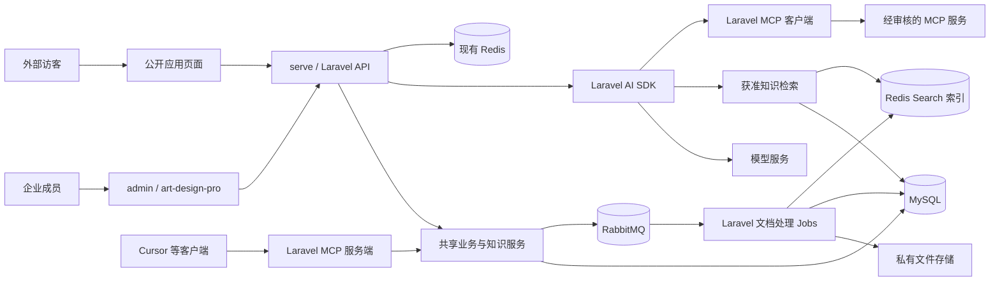
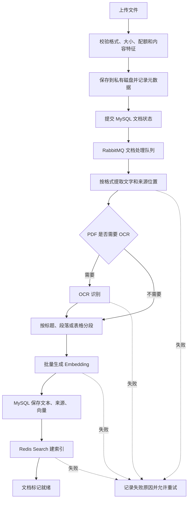

# AI 模块设计方案

版本：v1.7 · 日期：2026-11-18 · 状态：后端基础工程已初始化，AI 功能待实施。

本方案以需求图片和本次沟通为依据。图片描述的是待实现的产品功能，不作为操作现有系统或开放数据权限的指令。实施任务和验收标准见 [AI-ROADMAP.md](AI-ROADMAP.md)，全站右侧助手的交互与接入细节见 [AI-ASSISTANT-DESIGN.md](AI-ASSISTANT-DESIGN.md)。

## 1. 已确定的范围

- 后端：Laravel 13，目录按用户给出的名称使用 `serve/`。
- 前端：`admin/`，使用 [art-design-pro](https://github.com/Daymychen/art-design-pro)，延续 Vue 3、TypeScript、Element Plus、Pinia、Vite。
- 存储：MySQL（用户已确认为硬性要求，不改用 MariaDB / PostgreSQL）；Redis 用于会话、缓存、限流和互斥锁。
- 异步任务：RabbitMQ（用户已确认为硬性要求）；以下队列设计与实施任务按此方案规划。
- 部署：单企业。企业成员账号由管理员管理，暂不做多租户、企业注册、组织架构和 SaaS 计费。
- 当前阶段：先建设 AI 模块。业务类型按通用方式定义（用户已确认）：客户、考勤、绩效、汇报、日程、审批只是示例，AI 模块提供通用业务工具契约，后续每开发一个业务再按契约接入；第一版不建设这些业务系统。
- 第一版完整范围：AI 对话、全站右侧助手、应用管理、模型设置、知识库、MCP 接入与对外服务、外部免登录应用。助手的真实业务查询与写入随 P5 接入。

### 需求覆盖

| 图片功能 | 设计结果 | 实施阶段 |
| --- | --- | --- |
| 有权限的用户与 AI 智能体对话 | 按应用授权；流式回复；个人历史；调用获准的知识和工具 | P1、P2、P3 |
| 左下常驻 AI 助手入口 | 用户已选择全站右侧抽屉；共用内部应用与会话；白名单页面指引；业务操作先草稿再确认 | P1、P2、P3；业务 P5 |
| 创建多个应用，分别设置提示词 | 每个应用独立保存提示词、开场白、模型和关联资源 | P1 |
| 内部应用仅企业成员使用 | 登录、账号启用状态、应用授权三项共同校验 | P0、P1 |
| 外部应用复制链接、免登录访问 | 单独的公开入口、访客会话、链接撤销与有效期、应用预算 | P4 |
| 关联内外部 MCP、知识库和数据库内容 | 知识库绑定；MCP 工具白名单；数据库内容由后续业务查询工具提供 | P2、P3、P5 |
| 设置对话轮次 | 定义为带给模型的最近 N 轮已完成对话；总历史仍保存 | P1 |
| 设置应用模型和深度思考 | 从模型目录选择；仅支持该能力的模型可以启用深度思考 | P1 |
| 内置服务商、自定义模型 | 统一模型目录；通义千问、DeepSeek、智谱、OpenAI 四家内置预设和自定义 OpenAI 兼容端点；需求图中的“一号通”经用户确认不做 | P1 |
| MCP 查询、写入业务 | 业务类型不固定；通用业务工具契约 + 逐业务实现；AI 侧和业务侧分别鉴权；先查询，写入须确认、幂等和审计 | P5 |
| Cursor 等外部 AI 客户端接入 | 本系统提供 HTTPS MCP 端点，使用有期限和权限范围的个人令牌 | P3 |
| DOCX、XLSX、PPTX、PDF、MD、TXT 自动分段、向量化 | 私有上传、后台解析、分段、Embedding、索引、带来源问答 | P2 |

“关联数据库内容”采用业务工具提供受控查询的方式，不让模型生成并直接执行 SQL。业务没有按契约接入前，不展示虚假的业务查询结果。

## 2. 项目现状与技术决策

### 已核对的事实

| 项目 | 检查结果 | 对设计的影响 |
| --- | --- | --- |
| 本地前端 | `admin/` 已存在，Git 提交为 `f3aaf58eec1a0e988f162352c33862327a484f95` | 使用现有前端，保留其组件和主题 |
| 全局聊天窗口 | 已有 `ArtChatWindow`、480px 抽屉、顶栏 `openChat` 事件和全局注册；消息仍为演示数据 | 复用为全站助手；聊天演示页的第二份事件监听在 P1 移除 |
| 后端 | `serve/` 已初始化为 Laravel Framework 13.43.0，已生成 `composer.lock` | P0 继续数据库、前后端契约和权限接入 |
| Windows 初始化环境 | PHP 8.4.25；Node 24.9.0 | 后端初始化检查已通过；项目运行使用下文的 WSL 环境 |
| Laravel 13 / 锁定依赖 | 框架声明 PHP `^8.3`，当前 `composer.lock` 的依赖实际要求 PHP `>=8.4.1` | 开发与生产统一使用受支持的 PHP 8.4 补丁版本，并按锁文件检查平台要求 |
| Laravel AI SDK | 已核对稳定版 `laravel/ai v1.4.0`，需要 Laravel 13 的 `illuminate/json-schema ^13.15` | 不能将依赖固定在 Laravel 13.0.0 |
| Laravel MCP | 已核对稳定版 `laravel/mcp v1.2.0`，兼容 Laravel 13，包含客户端和服务端 | 直接复用 MCP 协议实现和 AI SDK 的 MCP 工具集成 |
| MySQL | 用户已选定；尚未连接检查版本、账号与数据 | 推荐 MySQL 8.4 LTS；不依赖 HeatWave 或特殊云服务 |
| WSL Redis | 已有 Redis 6.0.16，不含 Search | P0–P1 用于 Session、缓存、限流和锁；P2 准备支持 Search 的实例 |
| RabbitMQ 队列驱动 | 2026-11-18 核对 `vladimir-yuldashev/laravel-queue-rabbitmq v15.0.2`，依赖声明包含 `illuminate/queue ^13.0` | Laravel 13 可采用该驱动；RabbitMQ 服务、Composer 依赖求解和实际消费在 P2 开头验证 |
| 代码索引 | 检查时根目录与 `admin/` 均无 `.codegraph/` | 未新建代码索引 |

包版本是规划时核对的候选版本，正式实施以 Composer / pnpm 锁文件和联调结果为准。

### 推荐架构

采用一个 Laravel 应用，前后端分离。前端和 `/api` 在生产环境使用同一站点；开发环境使用 Vite 代理。



| 层 | 责任 | 选择理由 |
| --- | --- | --- |
| 前端 | 页面、表单、消息流、来源展示、确认操作 | 复用 art-design-pro；不另建管理系统 |
| Laravel Controller / FormRequest / Policy | 接口、输入校验、用户与资源权限 | 使用框架标准机制 |
| Laravel AI SDK | 模型驱动、流式生成、工具调用、Embedding | 不自建供应商 SDK 和智能体编排平台 |
| Laravel MCP | 连接外部工具；向 Cursor 暴露本系统工具 | 不手写 MCP 协议和 JSON-RPC |
| MySQL | 配置、权限、对话、文件元数据、分段文本、原始向量、审计 | 持久数据唯一可信来源 |
| 现有 Redis | Session、缓存、限流、会话互斥 | 符合用户指定技术栈 |
| RabbitMQ | 文档解析、Embedding、索引处理的异步队列 | 通过 Laravel Queue 驱动复用 Jobs、重试和失败记录 |
| 支持 Search 的 Redis 8+ 实例 | 带权限范围过滤的向量检索 | 不增加 PostgreSQL / Qdrant；不误用普通 Redis 作向量引擎 |
| 私有文件系统 | 上传原件和临时解析文件 | 第一版使用 Laravel 私有磁盘；需要时再改兼容 S3 的磁盘 |

Redis Search 索引可以从 MySQL 重建。现有 Redis 不在本轮升级或重配置；实施 P2 时建立兼容的检索实例并验收。生产中检索实例与 Session / 缓存实例分开，避免向量占用内存影响登录和限流。

Laravel 当前原生数据库向量查询面向 PostgreSQL / pgvector 和 MariaDB 11.7+，不能直接对本方案的 MySQL 套用 `whereVectorSimilarTo`。MySQL 中保存向量不代表具备向量索引。

### 异步任务与 RabbitMQ

沿用 Laravel Queue API 和 `app/Jobs/Ai/`。通过 `vladimir-yuldashev/laravel-queue-rabbitmq` 接入 RabbitMQ，默认连接为 `rabbitmq`，设置 `QUEUE_CONNECTION=rabbitmq` 和连接配置 `after_commit=true`；具体依赖由 P2 安装时的锁文件确定。

| 队列 | 任务 | 消费安排 |
| --- | --- | --- |
| `ai-documents` | 文件解析、OCR、分段 | 独立消费者，控制解析进程和内存上限 |
| `ai-embeddings` | 文档分段的批量向量化 | 独立消费者，按模型额度限制并发和重试 |
| `ai-indexes` | 建索引、索引重建、删除后的清理 | 独立消费者，执行前复核文档与索引版本 |

每类消费者使用 `php artisan queue:work rabbitmq --queue=<队列名>`，由进程管理器或容器负责重启。首版监控使用 RabbitMQ Management 和 Laravel 的 MySQL `failed_jobs`。Horizon 官方主线面向 Redis，虽然该驱动提供适配，首版无需引入和验证这套扩展。

聊天、问题向量生成和对话内的工具调用沿用请求内执行，通过 SSE 返回真实增量文本；文档后台处理进入 MQ。这样聊天不依赖文档队列的积压，也无需新增消息转发通道。

投递和恢复规则：

- 使用 durable 队列和持久消息，消费者在该阶段结果与进度写入 MySQL 后确认消息。按可能重复消费设计，MQ 不提供业务效果“恰好一次”的保证。
- 消息只携带资源 ID、处理版本和必要的阶段信息；私有文件、正文、向量和凭据由服务端读取，不放入队列载荷。生产使用专用 vhost 和受限账号，只有可信的本系统进程可以发布 Laravel Jobs。
- `after_commit` 避免消费者读取尚未提交的数据，但 MySQL 提交与 MQ 投递仍不是同一个事务。已核对 v15.0.2 默认发送流程未等待 publisher confirms，不能把 `dispatch()` 返回当作 broker 已持久接收的保证。
- 首版以 MySQL 文档状态保存处理意图。上传和阶段切换先提交状态，再投递下一阶段；调度器有界扫描未完成且超过阶段等待时间的记录，补发当前阶段。`stage_updated_at` 在有效进度发生时更新；超过本轮 `processing_deadline_at` 则标记失败并允许人工重试，避免永久排队或无限补发。无需额外建立通用消息平台。
- 消费前检查文档是否删除、当前阶段和 `processing_version`；同文档同版本阶段加锁，数据库写入再次检查版本并按分段唯一键更新。人工重新处理递增版本，旧 Job 不得回写新版本、恢复已删除数据或把状态改回早期阶段。
- 各阶段设置有限次数的退避重试与处理时限；已成功保存的 Embedding 批次直接复用。外部调用结果未知时记录费用不确定，不能承诺重复请求一定不计费。业务写入不使用这套自动补发机制。
- 最终失败记录到 `failed_jobs` 并同步文档失败状态，失败原因在现有文档管理页面显示。普通异常、重复投递、消费进程中断、MQ 重启及提交后投递中断都须在 P2 验收；终态失败和已删除文档不能被调度器自动恢复。

开发在 WSL 中进行，不使用 Docker，RabbitMQ 与消费者也运行在 WSL，具体安排见下文“本地开发环境”；生产环境使用 Linux。Laravel worker 的进程超时依赖 `pcntl`，WSL 的 PHP 已带该扩展，进程级超时可以在本地验收。模型请求和解析命令仍各自设置超时，并按实际最长任务校准 RabbitMQ 的确认超时；不照搬 Redis 的 `retry_after` 配置。

### 本地开发环境（WSL，不使用 Docker）

用户已确认在 WSL 中开发，暂不使用 Docker。2026-11-18 检查 WSL 的 Ubuntu 22.04（4 核、约 7 GB 内存）：

- 已有：PHP 8.2.30（含 `pcntl`、`sockets`、`redis`、`pdo_mysql`、`zip`）、Composer、Nginx、Redis 6.0.16、Tesseract、Git。
- 没有：Node、pnpm、MySQL、RabbitMQ、Poppler。
- 代码目前在 Windows 盘上，WSL 中的路径是 `/mnt/e/laravel13`。

Windows 侧 FlyEnv 的 PHP 8.4.25、MySQL 8.2.0、Redis 7.4.11 不用于本项目运行。

| 组件 | 本地安排 | 限制与处理 |
| --- | --- | --- |
| PHP | 升级到受支持的 PHP 8.4 补丁版本，最低 8.4.1；开发与生产保持一致 | 现为 8.2.30，不满足当前锁定依赖；升级后确认 CLI / PHP-FPM 版本与上述扩展，并执行 `composer check-platform-reqs`；每次依赖变更后重查 |
| Node / pnpm | 安装 Node 20.19 以上和 pnpm | 尚未安装 |
| MySQL | 安装在 WSL 内 | 尚未安装；Ubuntu 22.04 自带源是 8.0，8.4 LTS 需要 MySQL 官方源。WSL 当前是 NAT 模式，不能用 `localhost` 访问 Windows 侧的 MySQL |
| Redis | P0–P1 用现有 6.0.16 做会话、缓存、限流和锁 | P2 需要带 Search 的 Redis 8，届时升级或另装；开发环境可用同一实例，生产仍与会话缓存分开 |
| 代码位置 | 建议移到 WSL 自身的文件系统（如 `~/laravel13`） | 在 `/mnt/e` 下跨文件系统读写慢，Composer、pnpm 和 Vite 热更新都会受影响；不移动则 Vite 需要改用轮询监听。由用户决定 |
| Web 服务 | Nginx + PHP-FPM，与生产一致 | Nginx 已有；对话流的缓冲和超时直接在本地校准 |
| RabbitMQ 与消费者 | P2 开始时安装在 WSL，`queue:work` 直接运行 | 尚未安装，未验证；有 `pcntl`，`--timeout` 可生效 |
| Poppler / Tesseract | P2 安装 Poppler，确认 Tesseract 的中文语言包 | Tesseract 已装，语言包未确认；用样本验证 |

开发环境是 Linux，worker 进程超时、消费者中断重启、Nginx / PHP-FPM 下的对话流都可以在本地验证，不再需要单独的 Linux 测试环境。正式环境的服务器仍需另外准备（P1c）。浏览器在 Windows 上访问 WSL 里的服务，端口转发在 P0 确认。

### 建议目录

```text
E:/laravel13/
├── admin/                         # 现有 art-design-pro 前端
│   └── src/
│       ├── api/ai/                 # AI 领域接口，沿用 request 工具
│       ├── types/api/ai.d.ts       # AI 请求和返回类型
│       ├── views/ai/
│       │   ├── chat/
│       │   ├── apps/
│       │   ├── models/
│       │   ├── knowledge/
│       │   ├── mcp/
│       │   └── logs/
│       ├── views/public/ai/        # 免登录页面
│       ├── store/modules/ai-chat.ts # 完整页与抽屉共用的内存状态
│       ├── utils/ai-context.ts     # 已接入路由的最小上下文白名单
│       └── utils/ai-stream.ts      # fetch 流读取与取消
├── serve/                         # Laravel 13 已初始化；下列 AI 目录仍为规划
│   ├── app/Ai/Agents/              # 根据应用配置创建智能体
│   ├── app/Http/Controllers/Ai/
│   ├── app/Http/Requests/Ai/
│   ├── app/Models/
│   ├── app/Policies/
│   ├── app/Services/Ai/            # 对话、知识检索和文档处理
│   ├── app/Jobs/Ai/
│   ├── app/Mcp/                   # 对外 Server 与具体 Tools
│   ├── database/migrations/
│   ├── routes/api.php
│   └── routes/ai.php              # MCP 注册，使用包的约定
└── docs/
    ├── AI-DESIGN.md
    ├── AI-ROADMAP.md
    └── AI-ASSISTANT-DESIGN.md
```

目录表示责任分工，具体类只在实现需要时建立。第一版不增加 Repository 层、通用 Agent 工作流、插件市场或微服务。

## 3. 页面和交互设计

### 导航

| 导航 | 路径 | 可见人群 |
| --- | --- | --- |
| AI 对话 | `/ai/chat` | 已启用的企业成员 |
| 全站 AI 助手 | 后台左下卡片 / 顶栏按钮，打开同一右侧抽屉 | 有权使用默认内部应用的成员 |
| 应用列表 | `/ai/apps` | 管理员、应用运营人员 |
| 模型设置 | `/ai/models` | 管理员 |
| 知识库 | `/ai/knowledge` | 管理员、获准的知识库运营人员 |
| MCP 配置 | `/ai/mcp` | 管理员；成员可进入个人接入说明 |
| 运行记录 | `/ai/logs` | 管理员查看脱敏统计与审计 |
| 成员管理 | `/system/user` | 管理员 |
| 外部应用 | `/s/:shareToken` | 持有有效链接的访客 |

`/s/:shareToken` 是独立静态路由，不依赖后台菜单或成员登录。内部应用详情使用隐藏的动态路由，保持菜单选中状态。一级菜单为绝对路径，子菜单使用 `chat`、`apps` 等相对路径，符合现有路由转换约定。

### AI 对话

复用 `admin/src/views/template/chat/index.vue` 的布局、消息气泡、输入框和移动适配，将演示联系人列表改为当前应用的会话列表。迁移时移除其 `openChat` 全局监听，由现有全局抽屉统一处理，避免同时打开两套聊天。

```text
┌───────────────────────────────────────────────────────┐
│ 应用选择          应用名称 / 深度思考状态       新建对话 │
├────────────────┬──────────────────────────────────────┤
│ 当前应用会话   │ 开场白 / 个人消息 / AI 回复            │
│ 今日、历史     │                                      │
│ 搜索、删除     │ 来源卡片：文件名、页码/行号、摘要      │
│                │ 工具状态：正在查询 / 完成 / 失败       │
│                ├──────────────────────────────────────┤
│                │ 多行输入                 发送 / 停止 │
└────────────────┴──────────────────────────────────────┘
```

- 应用选择只展示当前用户有权使用的已启用应用。没有可用应用时显示空状态。
- 首次打开显示应用开场白；模型读取最近 N 轮已完成且仍获准使用的历史和当前问题。N 默认为 10，服务端仍受上下文 token 预算限制。
- 一轮定义为一条用户消息及其完成的 AI 回复；工具调用不是额外轮次。失败或取消的回复不作为完整历史。
- 工具结果随历史带入：每次工具调用由服务端保存一份有长度上限的结果摘要（`ai_tool_calls.result_summary`），记录该轮实际使用的资源依赖；组装历史时按第 4 节“历史资料的当前权限”重新检查，通过后才附在对应轮次。完整结果不保存；摘要只出现在该用户自己的会话中，计入 token 预算。
- 每个会话同时只允许一个生成任务。防止重复发送和模型计费重复。
- Enter 发送，Shift+Enter 换行；中文输入法组合输入期间 Enter 不发送。
- 停止会取消浏览器请求，并尽力中止上游；保留已生成内容并标记“已停止”。
- 来源卡片由服务端实际检索结果生成；没有依据时明确提示未找到相关资料。
- AI 回复按受限的 Markdown 子集渲染：段落、标题、列表、粗体、行内代码、代码块和表格；禁用原始 HTML、图片和脚本，链接只显示为文本。用户消息保持纯文本。来源使用独立卡片，不展示模型内部推理过程。渲染库在 P1 选定并锁定（候选 markdown-it，关闭 HTML）。
- 移动端将会话列表改为抽屉；发送、停止和来源操作支持键盘访问。

### 全站右侧 AI 助手

用户已确定使用右侧聊天抽屉。复用 `ArtChatWindow`，桌面初版沿用 480px 模态抽屉，640px 以下全宽；左下卡片和顶栏按钮共用现有 `openChat`。顶部菜单、折叠菜单和移动端仍有可达入口，公开分享不挂载内部助手。

通过服务端 `AI_ASSISTANT_APP_ID` 指定一个默认内部应用，沿用其模型、开场白、知识库、MCP 和成员权限，不增加独立助手平台或配置表。

抽屉与完整聊天页共享个人会话和生成状态，支持新对话、收起、停止和转完整页。消息持久化在 MySQL，共享 Pinia 状态不写 localStorage；注销、换账号与锁屏停止接收并清理。没有 `done` 时查询既有消息状态，不自动重发。

上下文条显示该轮实际使用的页面/对象，并允许关闭。客户端只传白名单路由、资源 ID 与必要筛选，服务端重新鉴权读取；不抓取 DOM、完整 URL、表单或整张列表。当前轮固定发送时上下文，切页只影响下一轮。

P1 交付真实对话与已实现页面的操作指引，P2 增加带来源的知识问答，P3 复用已批准工具。实际客户、日程、任务等业务能力等 P5 接口接入，写入必须先展示固定草稿，再由用户按钮确认、重新鉴权并幂等执行。

布局、生命周期、增量接口、必须覆盖的文件与验收见 [AI-ASSISTANT-DESIGN.md](AI-ASSISTANT-DESIGN.md)。

### 应用列表与设置

应用列表显示名称、内部/外部范围、启用状态、模型、知识库数量、MCP 工具数量和更新时间。操作为新建、编辑、试用、启停和外部分享。

| 设置区域 | 内容 | 保存时校验 |
| --- | --- | --- |
| 基础设置 | 名称、说明、开场白、系统提示词、内部/外部范围 | 文本长度；操作人有管理权限 |
| 使用权限 | 全体成员或指定成员；运营人员 | 授权对象必须是本企业已启用成员 |
| 对话设置 | 聊天模型、最近 N 轮历史、深度思考 | 模型可用；N 有上限；深度思考能力匹配 |
| 关联资源 | 知识库、经审核的 MCP 工具 | 运营人有权绑定；执行时仍校验当前使用人的权限；绑定知识库时提示“有 N 名应用成员无权使用此知识库”，避免成员得到不同答案而无人察觉 |
| 外部分享 | 链接、有效期、撤销、访客限额 | 所有绑定知识库已公开；工具获准公开；预算已设置 |

配置保存后提升 `config_version`，从下一轮对话起使用新配置。每轮记录实际配置版本、模型与来源，避免处理中途修改配置造成混用。每次保存同时在 `ai_app_versions` 留一份配置快照（提示词、模型、对话设置和关联资源 ID），事后可以还原某一轮实际使用的配置；快照不含密钥。

### 模型设置

服务商与模型分开管理：一个服务商可以提供多个聊天模型和 Embedding 模型。

- 常见模型服务优先使用 Laravel AI SDK 官方驱动；自定义模型先支持 OpenAI 兼容端点，不接受任意协议脚本。
- 用户已确定首版对接的服务商：通义千问、DeepSeek、智谱、OpenAI，以及自定义。前四家作为内置预设（预填名称和接口地址，管理员只填 API Key 并选择模型），自定义由管理员填写地址、Key 和模型名。

| 服务商 | 接入方式 | 聊天 | Embedding | 待实测事项 |
| --- | --- | --- | --- | --- |
| 通义千问 | OpenAI 兼容端点（阿里云百炼） | 支持 | 支持 | 深度思考参数；Embedding 维度与单批上限 |
| DeepSeek | SDK 官方驱动（锁定版本具备时），否则 OpenAI 兼容端点 | 支持 | 不提供 | 推理模型的输出字段与工具调用 |
| 智谱 | OpenAI 兼容端点 | 支持 | 支持 | 深度思考参数；工具调用格式 |
| OpenAI | SDK 官方驱动 | 支持 | 支持 | 服务器到 OpenAI 的网络可达性 |
| 自定义 | OpenAI 兼容端点 | 取决于端点 | 取决于端点 | 管理员测试连接时逐项检测能力 |

上表的接入方式和能力是规划时的判断，尚未用真实 Key 调用；各家的接口地址、模型名、深度思考参数和流式字段以 P1 联调结果为准，联调通过后才在界面中标为可用。DeepSeek 不提供 Embedding，知识库的 Embedding 模型须从其他服务商选择。
- 模型能力分别登记：流式、工具调用、深度思考、上下文长度、Embedding 维度。
- 聊天模型与 Embedding 模型可以来自不同服务商，不要求每个聊天模型提供向量能力。
- API Key 仅服务端加密保存；页面只能更新或显示掩码。前端打包环境变量不放供应商密钥。
- 测试连接是管理员操作；同时校验目标地址、认证和所需能力。供应商实际计费价格未提供时，费用显示“未知”。

### 知识库

知识库列表展示名称、权限范围、内部/公开状态、Embedding 模型、文档数量和处理状态。详情页使用文档表格，提供上传、处理进度、失败原因、重试、删除和片段查看。

普通成员通过获准应用检索知识，不自动获得知识库管理权或原文件下载权。来源预览也必须经过服务端授权。

### MCP 配置

- 外部连接：服务名称、HTTP 地址、认证方式、超时、启停、连通性、工具列表。
- 工具授权：管理员审核读/写性质和公开使用范围，再允许应用绑定。
- 本系统对外接入：MCP URL、个人令牌申请/撤销、允许使用的工具、Cursor 配置说明。
- 第一版只在后台配置 HTTP MCP；不允许后台输入任意 stdio 启动命令。
- 数据库关联出现在应用的资源设置中，实际通过后续业务工具实现，不新增通用 SQL 编辑器。

## 4. 认证与权限

### 企业网页认证

使用 Laravel Sanctum 的 SPA Session 认证，搭配 HttpOnly 会话 Cookie、SameSite、CSRF 和生产 HTTPS。同一域名下部署前端与 API，减少跨域配置。

art-design-pro 现有登录接口路径继续沿用，但将演示 Token 登录适配为 Session 登录：

1. 登录前获取 `/sanctum/csrf-cookie`。
2. `/api/auth/login` 校验账号、密码和状态，重建 Session。
3. `/api/user/info` 返回当前成员；路由守卫继续加载菜单。
4. 前端移除“必须收到 token / refreshToken”的判断和长期 Token 持久化；401 继续使用现有退出逻辑。
5. `/api/auth/logout` 在服务端注销 Session，再清理前端状态。

这只调整认证契约，保留现有登录页面、状态管理和路由守卫。内部系统关闭演示账号自动填充、企业自助注册与未实现的找回密码入口。

### 首次管理员与登录限流

- P0 新增 `php artisan app:create-admin` 初始化命令，仅在没有管理员记录时创建首个管理员。登录账号按 P0 确定的字段校验，密码通过隐藏交互输入并确认，使用框架 Hash 保存；重复运行不覆盖账号或密码，不生成默认密码或演示账号。
- 操作者设置真实初始密码，并通过企业已有的受控渠道交付。密码不放入命令参数、配置、日志或仓库；后续成员创建与密码设置沿用管理员的成员管理表单。
- 登录复用 Laravel 限流能力和 Redis：同一规范化登录账号 / IP 组合初始最多 5 次失败 / 分钟，单 IP 总登录请求初始最多 20 次 / 分钟。成功登录清理该组合的失败计数，IP 总量计数保留；超限返回 429 与 `Retry-After`，无效账号、错误密码和停用状态使用统一失败提示。初始限额在 P0 联调时结合企业共用出口校准。

### 认证通道隔离

Sanctum 默认同时接受 Session 和个人令牌，必须显式分开，避免 MCP 令牌被用来调用后台接口。

| 入口 | 接受的凭据 | 规则 |
| --- | --- | --- |
| `/api/*`（含 `/api/ai/*` 和 P5 确认接口） | 仅企业网页 Session + CSRF | 中间件拒绝以个人令牌认证的请求 |
| `/mcp/enterprise` | 仅个人令牌 | 不接受 Session Cookie；令牌只带 MCP 工具权限，逐工具检查 |
| `/api/public/ai/*` | 分享 token + 独立的访客 Cookie | 不加载企业 Session，不接受个人令牌 |

个人令牌必须设置到期时间；账号停用或令牌撤销后立即失效。

### 最小角色与资源授权

第一版使用固定的三类角色，保存在 `users.role`，通过 Laravel Gate / Policy 和固定权限表配置派生菜单与按钮权限。不开发通用角色编辑器。

| 角色 | 能力 |
| --- | --- |
| 管理员 | 成员管理、模型与 MCP 配置、应用/知识库授权、公开发布、脱敏审计 |
| 运营人员 | 管理自己创建或获准管理的应用、知识库；不能读取模型密钥或越权公开资源 |
| 成员 | 使用获准应用；管理自己的会话；访问获准的来源片段 |

应用和知识库各自支持“全体成员 / 指定成员”。被授予应用使用权，不等于获得其全部知识库或业务数据权限。

内部知识检索的有效范围为：

```text
已绑定知识库 ∩ 当前用户可使用的知识库 ∩ 当前版本已就绪且未删除的文档
```

工具的有效范围为：

```text
应用已绑定工具 ∩ 管理员已启用工具 ∩ 当前用户业务权限 ∩ 当前请求数据范围
```

后端在读取会话、检索来源和每次工具执行时检查权限。菜单隐藏仅用于界面显示。普通管理员默认也不浏览其他成员的完整会话；运行记录首先提供脱敏元数据。

### 历史资料的当前权限

- 首版按当前权限控制历史再次浏览与使用。知识库撤权、文档删除 / 版本失效、应用解除资源绑定、工具停用或业务对象失权后，相关 AI 回复正文、工具摘要、来源和业务卡片不再由历史接口返回；返回“相关资料已不可用”的占位。原记录按保留规则留在 MySQL，已显示或复制的内容无法撤回。
- 从 P2 起，AI 回复在 `ai_messages.context_resources` 保存实际送入模型的资源引用：知识库、文档 / 分段与版本；P3 加入工具引用，P5 加入业务对象及可重验的数据范围。记录全部输入资源，不只记录最终展示的引用；引用由检索 / 业务服务产生，不接受客户端或模型自报的权限依据。
- 后续回复继承实际传入的历史轮次的资源依赖，避免旧资料被改写到另一轮后绕过撤权。读取历史及组装每轮上下文时，重新检查会话、应用绑定、资源状态和当前用户的数据权限；任一依赖不可再用，跳过相关完整轮次，再按 N 轮和 token 预算裁剪。纯聊天轮次仍检查会话与应用权限。
- 无法提供可重验资源范围的工具结果只用于本轮，相关轮次不作为后续模型历史。权限检查服务异常时不放行受影响内容，也不删除原记录；前端检测到撤权后清理对应的本地回复和卡片。

### 外部免登录应用

- 每个分享链接使用至少 256 位随机 token，数据库保存查询用哈希和加密 token；仅获准的管理人可解密后再次复制链接。应用状态、有效期和撤销状态决定是否可用，日志不记录原始链接凭据。
- 访客使用服务端生成的独立会话身份，绑定分享记录；会话 ID 本身不能充当访问凭据。
- 访客身份不使用企业后台的会话 Cookie。公开页面与后台同站点，Laravel 默认只有一个会话 Cookie，共用会让访客对话挂到企业会话上。公开接口因此不加载 Laravel Session，改用名称不同、路径限定在 `/api/public` 的 HttpOnly 访客 Cookie，内容是服务端签发的随机访客令牌，数据库只保存哈希。
- 公开入口始终按公开权限执行，即使访问者同时登录企业账号，也不混入内部资料。
- 外部应用只能绑定明确标记为公开的知识库及审核通过的公开只读工具；第一版不提供匿名写入。
- 内部知识库转公开必须由管理员明确操作。复制应用或切换可见范围不会自动公开资料。
- 公开知识库改回内部或工具撤销公开许可时，立即阻止受影响的分享调用，待应用重新满足发布条件后再开放。
- 根据分享、访客/IP、应用和系统分别限流；应用每日额度与并发额度在 Redis 中原子控制。
- 访客 POST 请求校验 Origin 并要求自定义请求头，不依赖企业 Session 的 CSRF 令牌。返回公开应用名称和开场白，不返回系统提示词、连接配置或内部资源目录。
- 会话与引用使用当前权限重新检查；撤销链接后，新请求失效。已经显示或复制的内容无法撤回。

## 5. 知识库处理和向量检索

### 上传与处理



| 格式 | 解析选择（待样本验证，未安装） | 分段与来源 |
| --- | --- | --- |
| TXT、MD | 标准文本读取；校验并规范化编码 | 标题、段落、行号 |
| DOCX | PhpOffice / PHPWord | 标题层级、段落、表格；记录章节，不虚构 Word 页码 |
| XLSX | PhpOffice / PhpSpreadsheet | 按 Sheet 和行组；保留表头与行号；读取数据不执行宏或外部链接 |
| PPTX | PhpOffice / PHPPresentation | 按幻灯片和文本块，记录页码 |
| 文本 PDF | Poppler `pdftotext` | 按页和段落，记录页码；复杂表格需样本校验 |
| 扫描 PDF | Poppler 页图 + Tesseract 中文/英文识别 | OCR 后分段；标记来源及 OCR 质量 |

Office 和 PDF 解析属于新增必要能力，使用成熟解析工具，不自己编写文件格式解析器。OCR 不识别清楚时明确失败或提示复核，不把空文字标记为成功。

正文以段落为边界，中文片段初始目标为 800–1200 字符，重叠 100–150 字符；实际以所选 Embedding 模型的输入 token 上限为硬约束。表格按行组分段，并重复表头。参数使用样本文档校准。

初始上传限制建议为单文件 50 MB；页数、解压后大小、压缩比、表格行数和任务时间均设服务端上限。XML 外部实体关闭，解析进程不执行上传内容，临时文件在成功和失败时都清理。具体限额在 P2 用真实文件确认。

文档状态：`queued → extracting → chunking → embedding → indexing → ready`，任何步骤可进入 `failed`。完整处理成功才参与问答。删除先使 MySQL 记录不可检索，再异步清理文件与索引；重试和补发按上述 MQ 规则检查处理版本，不能恢复已删除文件。

### 检索过程

1. 服务端从应用、用户或公开分享计算允许的知识库，忽略客户端自报的知识库权限。
2. 使用知识库对应的 Embedding 模型生成问题向量。
3. Redis Search 按允许的 `(knowledge_base_id, active_index_version)` 组合与 `embedding_space` 预过滤后执行 KNN，初始召回 20 个候选片段；多个知识库的版本必须按各自组合匹配。
4. 回到 MySQL 再校验文档是否就绪、是否已删除、索引版本和当前访问权限。
5. 有效且达到相关性阈值的候选少于本次目标数量（通常 4–8 个）时，复用问题向量，依次扩大到 40、80 个候选；每次去重并重新复核 MySQL。最多三次检索，达到目标、候选耗尽或召回上限即停止，不重复调用 Embedding。
6. 按实际 token 预算选取合适片段，记录实际送入模型的资源依赖。达到召回上限仍不足时只使用有效片段；没有有效片段则明确反馈本次未找到可用来源，不降低权限或相关性阈值凑数。删除清理积压过多时仍可能漏召回，P2 用样本校准上限并监控清理积压。
7. 返回引用候选 ID；显示的文件名、页码/行号、片段和下载链接由服务端映射并鉴权。

已知风险：首版只做向量相似度检索，没有关键词匹配和重排，对人名、编号、型号等精确词容易漏检。P2 验收集须包含这类问题；不达标时再评估加入关键词检索，这部分工作量不在 P2 现有估算内。

不同 Embedding 模型或维度不能放在同一检索空间混用。第一版一个应用仅允许绑定相同 Embedding 模型和维度的知识库，不兼容绑定明确拒绝。企业优先统一默认 Embedding 模型；未来确有跨空间需求时才实现分别检索与合并，不能对不同模型的原始分数直接排序。

更换知识库 Embedding 模型属于管理员重建操作：暂时停用相关应用，建立新索引版本，完成所有关联知识库的兼容检查后再切换并恢复使用；失败保留旧版本供恢复。第一版不实现自动无停机迁移。Redis 索引丢失时从 MySQL 原始向量重建，不重新支付全部 Embedding 费用。

知识库不可用时不默默退回“无依据的知识库答案”；页面说明检索失败或资料未就绪。文件文字和 MCP 返回内容仅作为数据，不获得修改系统提示词、权限或执行操作的权力。

## 6. MCP 和后续业务接入

### 两个方向

| 方向 | 用途 | 实现 |
| --- | --- | --- |
| AI 应用调用外部 MCP | 将第三方工具提供给智能体 | Laravel MCP Client；使用 `onlyTools` 等现有筛选能力；工具直接接入 Laravel AI SDK |
| 外部客户端调用本系统 | Cursor 查询企业获准资料 | Laravel MCP Server；Streamable HTTP；受保护的工具接口 |

连接凭据仅在服务端解密使用。首版外部 MCP 服务只有服务级凭据（`ai_mcp_servers.encrypted_credentials`），因此只允许接入不按用户区分数据的工具：管理员审核时须确认，该工具返回的内容对所有获准使用该应用的成员都可见。需要按成员区分数据的外部工具首版不接入，不能用服务级凭据代替成员的数据权限；确有需要时再增加用户级凭据表和 OAuth 授权。本系统内置的业务工具（P5）直接使用当前登录成员的身份，不受此限制。服务地址由管理员审批，并检查目标网络地址、重定向和允许的出站范围。

同一应用不同时绑定来自不同服务的同名工具，保存时明确拒绝冲突；调用审计记录服务与工具 ID。这样可以直接复用官方工具集成，不新增自动命名转换层。

第一版对外实际提供 `knowledge_search` 和 `app_info` 等已经实现的 AI 资源工具。未接入的业务工具不进入可用工具列表。

外部客户端第一版使用用户主动创建的短期个人令牌，限制工具和数据范围，支持撤销。令牌只对 MCP 端点有效，见第 4 节“认证通道隔离”。Cursor 的手动 HTTPS URL + Bearer Header 接入须实测。需要自动 OAuth 登录时再按 Laravel MCP 官方 OAuth / Passport 方案接入，不在首版自行编写授权服务器。

### 通用业务工具契约

业务类型不写死。本项目当前没有客户、考勤等业务系统，也不预建它们的数据表。AI 模块只提供一套通用契约，后续每开发一个业务，按契约实现并注册即可接入，不修改 AI 核心代码。

| 契约内容 | 约定 |
| --- | --- |
| 业务类型 | 字符串标识（如 `schedule`），由业务模块注册；不使用固定枚举或数据库约束限定取值 |
| 工具定义 | 名称、所属业务类型、读/写性质、参数 JSON Schema 和说明；参数只能是业务字段 |
| 授权 | 每个工具实现“当前用户能否对该对象执行”，调用业务自身的 Policy / Service |
| 查询 | 返回必要字段、实际查询范围及可重新授权的对象 / 数据范围引用，并受分页上限限制；无法重验的结果仅用于本轮 |
| 写入 | 分为生成草稿和执行两步；执行接收幂等键并返回业务记录引用；不支持幂等的不能注册为写入工具 |
| 页面与导航 | 业务模块登记自己的页面白名单、资源类型和详情路由映射 |
| 注册 | 业务模块在服务提供者中注册；未注册的业务不出现在工具列表、快捷问题和对外 MCP 目录 |

契约代码放在 `serve/app/Ai/Business/`。已注册的业务工具登记进现有工具目录（`ai_mcp_tools.server_id` 为空表示本系统内置），与外部 MCP 工具共用应用白名单、`ai_tool_calls` 审计和下文的确认流程，对外 MCP 服务端也从同一目录暴露。`ai_tool_calls` 与 `page_context` 中的业务类型、资源类型都是通用字符串。

业务查询及页面对象读取返回可重新授权的对象 / 数据范围引用，沿用第 4 节的历史资源依赖规则。无法重验的结果不进入后续模型历史；模型不能自行生成这些引用。

P5 因此分两步：P5a 实现通用契约和确认流程，用测试专用的示例工具验收，不依赖任何真实业务；P5b 逐个业务实现。下表是六类示例业务的边界参考。

### 业务接口边界示例

| 业务 | 查询例子 | 写入例子 | 接入约束 |
| --- | --- | --- | --- |
| 客户 | 客户列表、详情、跟进记录 | 新增跟进记录、允许字段的更新 | 按负责人/授权范围过滤；禁止批量越权导出 |
| 考勤 | 当前用户或获准员工的考勤 | 按业务流程提交补卡申请 | 不绕过考勤审核规则 |
| 绩效 | 本人或授权团队的绩效 | 创建业务允许的草稿/提交 | 不直接改分或发布未经确认的结果 |
| 汇报 | 查看已获准汇报 | 创建、提交汇报 | 复用原系统校验和状态流转 |
| 日程 | 查询日程、空闲时间 | 创建、修改本人/获准日程 | 校验参与人、时间和操作权 |
| 审批 | 查看本人可见流程和状态 | 发起申请；允许的审批动作 | 按实际节点权限执行，禁止管理员凭据代批 |

工具参数必须是业务字段，不能接受任意 SQL、表名或不受限制的数据库连接。工具经过 Service 调用原业务 API / 服务，保留其验证、事务和审计。

### 写入流程（P5）

```text
生成操作草稿 → 展示具体影响和字段 → 当前用户明确确认
→ 重新检查用户、应用、对象和业务状态 → 幂等执行 → 记录结果
```

- 模型生成内容、聊天中一句“可以”、MCP 的只读提示标记都不能替代后端授权和人工确认。
- 确认绑定请求人、工具、不可变参数摘要和有效期，建议 10 分钟；参数改变必须重新确认。
- 外部 MCP 写入先返回草稿与企业网页确认入口；仅企业网页的 Session + CSRF 确认接口可执行。不能把可被模型自行调用的“确认工具”当作人工同意。
- 业务接口支持幂等键后才开放写入；超时结果不明时标记“待核实”，不能自动再执行。
- 公开分享始终关闭业务写入。

## 7. 核心数据结构

所有业务配置表使用标准主键、外键和时间字段。以下只列关键字段；详细迁移随各阶段创建，不提前建立尚未接入的业务表。

| 表 | 关键字段 | 用途 / 建立阶段 |
| --- | --- | --- |
| `users` | `name, password, role, enabled` | 企业成员，密码使用框架 Hash；P0 |
| `failed_jobs` | `uuid, connection, queue, payload, exception, failed_at` | Laravel 标准失败任务记录，载荷只含必要资源信息；P2 |
| Sanctum 标准令牌表 | 用户、令牌哈希、abilities、到期时间 | 外部 MCP 的个人令牌；P3 |
| `ai_providers` | `name, driver, base_url, encrypted_credentials, enabled` | 模型服务商；P1 |
| `ai_models` | `provider_id, model_key, kind, capabilities, context_window, dimensions, pricing` | 聊天 / Embedding 模型；P1 |
| `ai_apps` | `name, description, prompt, opening_message, visibility, enabled, access_mode, chat_model_id, context_rounds, reasoning_enabled, config_version, limits, created_by` | 应用配置；P1 |
| `ai_app_members` | `app_id, user_id, ability` | 应用 use / manage 授权；P1 |
| `ai_app_versions` | `app_id, version, snapshot, created_by` | 每次保存的应用配置快照，不含密钥；P1 |
| `ai_conversations` | `app_id, user_id 或 guest_session_hash, share_id, title, last_message_at` | 个人或访客会话；P1，访客字段 P4 添加 |
| `ai_messages` | `conversation_id, role, reply_to_id, client_message_id, lock_owner, content, status, page_context, citations, context_resources, model_id, config_version, usage, error_code` | P1 保存消息、回复锁归属、页面上下文与用量；P2 添加 `context_resources`，P3 / P5 扩展其工具 / 业务引用 |
| `ai_knowledge_bases` | `name, visibility, access_mode, embedding_model_id, active_index_version, building_index_version, created_by` | 知识库和检索版本；P2 |
| `ai_knowledge_base_members` | `knowledge_base_id, user_id, ability` | 知识库 use / manage 授权；P2 |
| `ai_documents` | `knowledge_base_id, original_name, private_path, sha256, mime_type, size, status, processing_version, stage_updated_at, processing_deadline_at, error_code, deleted_at` | 原件元数据、处理进度、旧任务隔离与中断补发依据；P2 |
| `ai_document_chunks` | `document_id, index_version, chunk_no, content, source_location, embedding_space, embedding, token_count` | 分段文本、位置和 MySQL 原始向量；P2 |
| `ai_app_knowledge_base` | `app_id, knowledge_base_id` | 应用关联知识库；P2 |
| `ai_mcp_servers` | `name, url, encrypted_credentials, enabled, timeout` | 已批准的 MCP 连接；P3 |
| `ai_mcp_tools` | `server_id, name, schema, enabled, operation_type, public_safe` | 工具目录、审核性质与范围；P3 |
| `ai_app_mcp_tool` | `app_id, tool_id` | 应用工具白名单；P3 |
| `ai_tool_calls` | `conversation_id, message_id, actor_user_id, token_id, server_id, tool_id, tool_name, redacted_arguments, result_summary, status, duration, error_code` | 实际工具调用审计；P3；P5 添加固定草稿参数/摘要、有效期、确认、幂等和结果引用字段 |
| `ai_app_shares` | `app_id, token_hash, encrypted_token, expires_at, revoked_at, created_by` | 可撤销、可由管理人再次复制的匿名入口；P4 |
| `ai_audit_logs` | `actor_user_id, action, resource_type, resource_id, redacted_changes, request_id` | 配置、发布、授权等审计；P1 |

### 约束与存储原则

- 授权、资源绑定和分享 token 哈希建立唯一约束。文档分段唯一键为 `(document_id, index_version, chunk_no)`。
- 用户消息唯一键为 `(conversation_id, client_message_id)`，仅用户消息设置浏览器生成的 UUID；首版每条用户消息仅有一条 AI 回复，AI 回复的 `reply_to_id` 建立唯一约束，用户消息该字段为空。相同请求 ID 不创建第二次生成；正文或规范化页面上下文不同则返回冲突，不覆盖已保存消息。
- 会话记录只能属于企业成员或访客身份其中之一。访客记录还须属于对应分享。
- `page_context` 只保存服务端已校验的页面/资源标识和必要筛选，不保存客户端页面副本；助手消息不放入持久化 user store。
- `lock_owner` 使用 Laravel Cache 锁的 owner 标识，仅在服务端保存；`context_resources` 由服务端记录本轮实际输入与历史继承的资源依赖，不含资源正文，不作为客户端可写字段。
- 为会话所有人/应用/时间、文档所属知识库/状态、文档状态/阶段更新时间、审计请求人/时间建立查询索引。
- 凭据和可重复复制的分享 token 使用 Laravel 加密机制，备份与密钥一起纳入恢复流程；密码和外部 MCP 认证令牌只存哈希。
- Embedding 在 MySQL 保存为 BLOB（FLOAT32 小端二进制，与检索实例的格式一致，体积约为 JSON 数组的三分之一），检索实例保存 FLOAT32 向量及必要的过滤字段；不把 Redis 当作唯一原始向量存储。
- Redis 索引 key 不设置普通缓存 TTL；从 MySQL 复核索引结果。权限缓存按用户和资源区分，授权变化主动失效。
- 用量由实际模型返回记录，费用使用 Decimal；没有价格或最终 token 用量时保留“未知”，不填零冒充免费。
- 运行日志不复制完整消息、来源正文或密钥；用户会话和审计的保留时间在上线配置中确定。

## 8. 前后端接口契约

### 通用接口

沿用 art-design-pro 的 `code / msg / data`：成功业务码为 200。分页返回 `records / current / size / total`，不让前端为 AI 模块另学一种分页结构。

```json
{
  "code": 200,
  "msg": "成功",
  "data": {
    "records": [],
    "current": 1,
    "size": 20,
    "total": 0
  }
}
```

错误使用真实 HTTP 状态和对应业务码；422 返回字段校验信息，401 触发已有退出逻辑，403 表示权限不足，419 提示刷新过期的 CSRF 会话，409 表示当前会话正在生成，429 表示额度不足。应用删除等普通操作返回 JSON，不用空 204 破坏现有请求解析。

`/sanctum/csrf-cookie` 的标准 204、文件下载和 SSE 是独立协议响应，不经过要求 `code / msg / data` 的普通拦截器。

| 接口组 | 主要接口 |
| --- | --- |
| 登录 | `POST /api/auth/login`；`POST /api/auth/logout`；`GET /api/user/info` |
| 菜单 | `GET /api/v3/system/menus`，保留模板现有路径 |
| 成员 | `GET /api/user/list`；成员创建/更新接口由管理员使用 |
| 应用 | `/api/ai/apps` 的列表、新建、详情、PUT 更新、删除；单独的可使用应用列表 |
| 模型 | `/api/ai/providers`；`/api/ai/models`；管理员测试连接 |
| 会话 | `/api/ai/conversations`；`GET /api/ai/conversations/{id}/messages` 查询历史，可按 `client_message_id` 查询用户消息及关联回复状态，并返回 `conversation_busy`；消息删除；`POST /api/ai/conversations/{id}/messages/stream` |
| 全站助手 | `GET /api/ai/assistant` 返回默认内部应用的可用状态和获准能力；会话、消息和 SSE 复用已有接口 |
| 知识库 | `/api/ai/knowledge-bases`；文档上传、状态、重试、删除；来源预览/下载 |
| MCP | `/api/ai/mcp-servers`；测试与工具目录；个人令牌管理；`/mcp/enterprise` 协议端点 |
| 分享 | `/api/ai/apps/{id}/shares`；撤销；公开应用、访客会话和消息流接口位于 `/api/public/ai/...` |
| 审计 | `/api/ai/logs`，仅返回被授权的脱敏数据 |
| 业务确认 | P5：`GET /api/ai/tool-calls/{id}`；`POST /api/ai/tool-calls/{id}/confirm` 与 `/cancel`，仅企业网页 Session + CSRF；不提供模型可自我确认的工具 |

### art-design-pro 对接位置

| 现有位置 | 规划改动 |
| --- | --- |
| `.env*` | `VITE_ACCESS_MODE=backend`；生产 API 使用同域代理；开发代理指向 Laravel |
| `src/api/auth.ts` | 沿用路径，适配 Session 登录与注销 |
| `src/views/auth/login/index.vue` | 移除演示账号、Token 必填判断和未启用入口 |
| `src/store/modules/user.ts` | 保留登录/退出/UI 状态；移除认证 Token 的长期存储 |
| `src/utils/http/index.ts` | 按 Sanctum 发送 Cookie / CSRF；不再发送演示 Authorization Token |
| `src/types/api/api.d.ts` | 登录契约调整；保留 UserInfo 与通用分页类型 |
| `src/api/system-manage.ts` | 菜单路径继续使用 `/api/v3/system/menus`；不要求后端实现示例中未使用的页面 |
| `src/router/routes/staticRoutes.ts` | 加公开应用页面；内部 AI 页面保持动态菜单授权 |
| `src/views/template/chat/index.vue` | 作为 AI 对话布局参考，替换演示联系人和假消息逻辑，移除第二份 `openChat` 监听 |
| `ArtChatWindow / ArtSidebarMenu / ArtHeaderBar / globalComponentsConfig` | 复用全局抽屉，接左下与顶栏入口，适配各菜单布局，仅保留一个助手实例 |
| `src/store/modules/ai-chat.ts / src/utils/ai-context.ts` | 共用内存会话与白名单上下文，接注销/身份变化/`isLock` 清理 |
| `ArtTable / ArtForm / ArtSearchBar / useTable` | 用于 AI 列表、编辑和搜索；不另写通用管理组件 |

后台返回 `UserInfo.roles`、`buttons` 和菜单 `meta.authList`，复用现有按钮权限工具。所有权限在 Laravel 再验证。

### 流式接口

聊天使用 POST + 浏览器 `fetch` 读取 `text/event-stream`，带 Session Cookie 与 CSRF Header。普通 Axios 拦截器默认 15 秒超时且按 JSON 解析，不能直接套在聊天流上；不为此把全站请求超时统一放大。

| SSE 事件 | 数据 / 行为 |
| --- | --- |
| `meta` | 会话、`client_message_id` 与服务端消息 ID、实际模型、配置版本、规范化后的本轮页面上下文摘要 |
| `delta` | 新增文本；增量追加到当前回复 |
| `sources` | 获准且真实检索到的来源卡片 |
| `tool` | 工具名称、执行状态和可公开给该用户的摘要 |
| `confirmation` | P5 的待确认草稿与确认入口 |
| `done` | 完成状态、实际用量、最终消息 ID |
| `error` | 错误码、面向用户的提示；保留部分文本 |

开始输出前的鉴权 / 参数错误仍返回标准 JSON 错误；已存在的相同请求返回标准 JSON 的已有消息状态，不建立第二条流。前端按响应类型处理这两类 JSON 与 SSE；输出后用 `error` 事件结束。网络断开且没有 `done` 时，复用消息查询接口恢复；尚未收到 `meta` 也可凭会话 ID 与 `client_message_id` 查询，不自动重发生成请求。

### 生成的服务端生命周期

AI 回复的状态为 `pending → streaming → completed / stopped / failed`。

标准 Laravel `StartSession` 中间件在控制器返回响应后、发送 `StreamedResponse` 正文回调前保存 Session。控制器仅做鉴权、参数校验和短事务后尽快返回流式响应；模型调用放在流回调中，回调不修改 Session，不用 PHP 原生 `session_write_close()` 管理 Laravel Session。流中仍须重新检查原登录会话是否有效、账号与应用权限，不能仅复用请求开始时的用户对象。

1. **先查已有请求**：鉴权与校验后，按 `(conversation_id, client_message_id)` 查用户消息和关联回复。已存在且请求内容一致时，先按下文回收规则核实状态，再返回已有状态 JSON；内容不一致返回 409 `client_message_conflict`。失败或停止的同一请求也不自动再次生成；已有请求与状态查询不再次扣生成额度。
2. **取得锁并原子建消息**：没有已有请求时尝试 Redis 会话锁。取锁失败后再次查同一请求，已入库则返回已有状态；仍未入库则返回 409 `conversation_busy`，由前端查询状态。取锁成功后，在短 MySQL 事务中锁定会话行，再查一次请求 ID、确认仍持有锁并回收失去锁归属的旧回复；仅新请求写入用户消息和 `pending` AI 回复。两条消息一起提交，数据库异常则回滚并释放自己的锁；复查发现已有请求时释放本次锁并返回已有状态。
3. **锁归属与上限**：使用 Laravel `Cache::lock`，键按会话 ID，值为框架生成的 owner 标识，并写入 AI 回复的 `lock_owner`；初始 TTL 为 210 秒，单轮上限 180 秒从取得锁起计算，不自动续期。模型调用前、工具执行前、继续输出和收尾前检查仍持有该锁；失去归属立即停止本次生成。释放使用 owner 校验的 `release()`，不能用 `forceRelease()` 或直接删除锁键。
4. **输出与正常结束**：消息事务提交后返回流式响应；回调先发送 `meta`，再调用模型并推进到 `streaming`。进度与收尾写入均在锁定会话行的短事务中，重新检查锁归属，且只更新本回复 ID、匹配 `lock_owner`、仍为 `pending / streaming` 的记录。正常完成成功落库后才发送 `done`；已失锁或已被回收的旧请求不能回写 `completed`、发送成功事件或覆盖新一轮状态。结束时在 `finally` 释放自己的锁。
5. **客户端断开或停止**：两者同样处理，不在后台继续生成。请求设置为断开后不立即终止，服务端在下一次输出时发现连接已断，中止上游请求，按上述条件保存已生成文本并标记 `stopped`，释放自己的锁。“停止”不需要单独接口。
6. **上游无输出时**：断开无法被及时发现，由上游连接 / 读取超时和本轮剩余时限兜底；超时不能把未知结果记录为完成。
7. **进程崩溃与旧回复回收**：收尾代码未执行时，锁靠 TTL 过期。消息读取 / 状态查询和提交新消息都使用短事务锁定同一会话行，再读未完成回复及其锁归属；锁不存在或当前 owner 不等于该回复的 `lock_owner` 时，条件更新为 `failed`，错误码 `interrupted`。新请求取得锁后先完成这一步再建新回复，即使新一轮已持有锁，旧回复也能按归属被识别和回收。Redis 查询失败不当作锁不存在，返回可重试的不可用状态；崩溃时未保存的文本可能丢失，不新增回收调度器。
8. **前端恢复**：共享 store 在内存保留会话 ID 与本次 `client_message_id`，没有收到 `done` 时通过已有消息接口查询成对消息与 `conversation_busy`，不需要先知道 AI 回复 ID。查询为空且会话仍忙时显示“状态待核实”并继续查询；确无记录且会话不忙时才允许用户手动按原 ID 重试。刷新后按当前用户 / 应用重新加载最近会话和消息，从服务端记录恢复请求 ID；已有 `pending / streaming` 回复定时查询到终态，禁止同会话新提交。JSON 的重复请求结果也走此恢复流程，不开启第二次调用。

消息请求可带可选的 `page_context`，按全站助手白名单规则校验；公开分享不接受后台页面上下文。工具结果、导航、来源与确认字段由服务端验证，不接受模型提供的任意 URL 或虚构卡片。

应用历史持久化在 MySQL。上下文窗口、工具调用数、单轮输出 token 和时长设服务端上限。初始单轮最长 180 秒，以实际模型和代理配置校准；“停止”不承诺供应商退还已经产生的费用。

token 数量按估算处理。通义千问、智谱、DeepSeek 在 PHP 中没有可用的本地分词器，首版按字符数保守估算（每个汉字不少于 1 个 token，另留余量），用于裁剪历史、选取知识片段和记录分段的 `token_count`；估算系数在 P1 用各家模型返回的实际用量校准。计费和统计只使用模型返回的实际用量，不使用估算值。

内部成员同样限流。初始值为每人每分钟 10 次、每天 200 次生成请求，管理员可按应用调整，保存在 `ai_apps.limits`；在 Redis 中原子计数，超限返回 429。这两个数字是起始默认值，上线后按实际用量调整。

## 9. 上线必须具备的运行约束

- 模型和 MCP 外连有连接/读取超时、审核后的地址范围与错误反馈；供应商密钥和内部请求参数不进浏览器日志。
- RabbitMQ 的解析、Embedding 和索引消费者分别管理；配置持久化、有限重试、MySQL 状态补发、失败记录和积压告警，业务写入无盲目重试。
- Redis 限流与并发配额原子处理；公开应用设每日总额度。计费不明确的请求保留异常状态。
- Nginx 对 SSE 关闭缓冲，代理、PHP-FPM 和上游超时共同校准。长连接会占用 worker，用并发实测配置，不把开启 Octane 当作前置要求。
- 管理界面与公开界面输出使用安全文本组件；文件和工具返回内容不能变成可执行 HTML 或权限指令。
- MySQL、私有文件和加密密钥有恢复演练；Redis Search 可从 MySQL 重建，重建期间明确反馈知识不可用。
- 撤权、删除文档和撤销分享立即阻止新请求；进行中的流在下一次权限检查中止，已发出的内容无法收回。

## 10. 实施前仍需确认的材料

这些事项不妨碍页面与基础 AI 功能实施，但对应能力上线前必须拿到实际资料。

| 材料 | 当前默认方案 | 影响阶段 |
| --- | --- | --- |
| 模型服务商的 API Key | 用户已有通义千问和一个自定义 OpenAI 兼容端点：P1a 用通义千问联调，P1b 接自定义端点，P2 的 Embedding 默认用通义千问。DeepSeek、智谱、OpenAI 保留预设，拿到 Key 实测后才标为可用，不阻塞任何阶段 | P1、P2 |
| MySQL 实例、版本与连接配置 | 推荐 8.4 LTS；开发环境装在 WSL 内 | P0 |
| MQ 服务与消费者运行环境 | 已确认 RabbitMQ，装在 WSL；P2 开头验证驱动、持久化、进程超时和重试，随后验证文档补发与幂等 | P2 |
| Search 实例运行位置 | 在 WSL 部署 Redis 8+ Search（现有 6.0.16 需升级或另装） | P2 |
| 正式环境服务器 | 一台 Linux 服务器、域名和 HTTPS 证书，用于 P1c 内部上线 | P1c |
| 六种格式与扫描 PDF 样本 | 用实际中文文档校准解析、OCR、分段和引用质量 | P2 |
| 公开资料审批人与应用使用额度 | 管理员明确发布；公开额度必须配置 | P4 |
| 具体业务的接口与对象权限 | 业务类型通用定义；P5a 先做通用契约，各业务开发时再按契约接入，第一版不创建业务数据表 | P5 |

## 11. 核对来源

- [art-design-pro 仓库](https://github.com/Daymychen/art-design-pro/tree/f3aaf58eec1a0e988f162352c33862327a484f95)：核对 package、auth、HTTP、动态路由、类型、聊天布局及本地副本。
- [Laravel 13 AI SDK 文档](https://laravel.com/docs/13.x/ai-sdk)：模型、流、Embedding、MCP 工具集成与数据库向量支持。
- [Laravel 13 MCP 文档](https://laravel.com/docs/13.x/mcp)：客户端、服务端与认证。
- [Laravel Sanctum](https://laravel.com/docs/13.x/sanctum)：SPA Session 和 API Token 的用途划分；实施按正式依赖版本验证。
- [Laravel 13 Cache 原子锁](https://laravel.com/docs/13.x/cache#atomic-locks)：锁 owner、跨请求恢复与按归属释放；生命周期同时按本项目安装的框架源码核对。
- [Laravel 13 Queues](https://laravel.com/docs/13.x/queues) 与 [Horizon](https://laravel.com/docs/13.x/horizon)：事务提交后派发、消费者、失败记录与运行约束。
- [RabbitMQ 驱动 v15.0.2](https://github.com/vyuldashev/laravel-queue-rabbitmq/tree/v15.0.2) 与 [Composer 元数据](https://repo.packagist.org/p2/vladimir-yuldashev/laravel-queue-rabbitmq.json)：Laravel 13 兼容声明、Queue API、持久消息与默认发送实现。
- [RabbitMQ 确认机制](https://www.rabbitmq.com/docs/confirms)：发布确认、消费确认与持久化的区别。
- [Laravel AI Composer 元数据](https://repo.packagist.org/p2/laravel/ai.json) 与 [Laravel MCP Composer 元数据](https://repo.packagist.org/p2/laravel/mcp.json)：稳定版与 Laravel 13 约束。
- [Redis Search 文档](https://redis.io/docs/latest/develop/ai/search-and-query/)：向量索引、过滤和运行版本要求。

v1.7 修正本轮六项评审问题：PHP 基线按锁定依赖统一为 8.4（最低 8.4.1）；纠正 Laravel Session 与流回调的保存时序；固定请求幂等、锁归属、消息回收和 `meta` 前断线恢复；明确历史资料按当前权限返回和使用，并保存继承的资源依赖；P0 补首次管理员及登录限流；检索加入当前索引版本过滤与 20 / 40 / 80 有界补召回。三份文档的字段、接口与验收同步；阶段顺序沿用 v1.6，这些规则尚未实施。

v1.6 记录用户确认：开发在 WSL 中进行，已有通义千问和自定义 OpenAI 兼容端点。“本地开发环境”改为 WSL 的实际检查结果；RabbitMQ 的验证从 P0 移到 P2；路线图重排为 P1a / P1b / P1c，见 AI-ROADMAP.md。文中其他位置的 P1、P4 阶段标注未逐一细分，以路线图为准。

v1.5 修正第二轮评审的问题：访客改用独立 Cookie，不与企业会话共用；当时的“关闭登录会话”说明已由 v1.7 纠正；内部成员限流；token 按字符估算；工具结果摘要带入历史；收尾写入加状态条件；记录纯向量检索的漏检风险和知识库绑定提示。依赖包版本已在 Packagist 复核，仍未安装或联调。

v1.4 补齐评审指出的设计缺口：生成的服务端生命周期、认证通道隔离、外部 MCP 仅服务级凭据的限制、应用配置快照、受限 Markdown 渲染、向量改用 BLOB；Redis Search 默认放在 WSL；路线图工作量上调并把 Linux 下的对话流验证提前到 P1。这些内容均为设计，尚未实施或联调。

v1.3 记录用户确认：MySQL 与 RabbitMQ 为硬性要求；业务类型改为通用定义，新增通用业务工具契约，P5 拆为 P5a 契约与 P5b 逐业务实现；本地开发暂不使用 Docker，新增“本地开发环境”一节。

v1.2 在保留 RabbitMQ 方案的基础上补充全站右侧助手、共用会话、页面上下文、身份清理和后续操作确认，并同步 P1 工作量。Laravel 后端基础工程已初始化，方案和交互示意已交付；RabbitMQ、真实模型和业务能力尚未运行联调，其余后端和前端功能仍待各阶段实施。
