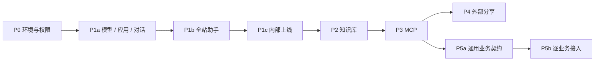

# AI 模块实施规划

版本：v1.7 · 日期：2026-11-18 · 设计依据：[AI-DESIGN.md](AI-DESIGN.md)、[AI-ASSISTANT-DESIGN.md](AI-ASSISTANT-DESIGN.md) · 状态：P0 进行中，后端工程初始化已完成。

## 1. 总体顺序和工作量

先做一个能真实使用的企业内部闭环并上线，再扩大资源和公开范围。每阶段完成验收后再进入下一阶段，业务接入单独计算。

| 阶段 | 交付结果 | 参考开发日 | 前置条件 |
| --- | --- | --- | --- |
| P0 | WSL 开发环境、Laravel 工程、前后端契约、登录、成员与权限 | 4–6 | WSL 内 PHP 8.4（最低 8.4.1）、Node、MySQL 就绪 |
| P1a | 通义千问真实对话、模型与应用管理、完整聊天页、个人历史 | 5–7 | P0；通义千问 API Key（已有） |
| P1b | 全站右侧助手、页面上下文、自定义 OpenAI 兼容端点、内部限流、运行记录页 | 6–8 | P1a；自定义端点的地址和 Key（已有） |
| P1c | 内部上线：正式环境部署、HTTPS、备份恢复、基本监控 | 2–3 | P1b；一台正式环境的 Linux 服务器 |
| P2 | RabbitMQ、六种格式上传、异步处理、OCR、向量检索、来源引用 | 13–17 | P1c；Embedding 模型、Redis 8 Search、样本文档 |
| P3 | 经授权的 MCP 调用；Cursor 等客户端接入本系统 | 6–9 | P2；测试 MCP 服务与客户端 |
| P4 | 免登录分享、公开数据隔离、公开额度 | 4–6 | P3；可公开的知识样本 |
| P5a | 通用业务工具契约、注册机制、草稿确认与幂等流程 | 约 3–5（粗估，未细化） | P3；不依赖具体业务 |
| P5b | 按契约逐个接入实际业务（客户、考勤等仅为示例） | 待各业务评估 | P5a；该业务已开发并有权限规则 |

工作量说明：

- P0–P4 的开发时间合计 40–56 个开发日。
- 上表不含联调返工和修缺陷的时间，按约 20% 另留 8–11 日，合计 48–67 个开发日，约一名熟悉 Laravel 与 Vue 的开发者 10–14 周。
- 加上 P5a 为 51–72 个开发日。P5b 取决于实际业务，不在其中。
- 这些是经验估算，没有按任务逐项拆分，也不是交付日期承诺。复杂扫描件、供应商接口差异和运行环境问题会改变工作量。

相对 v1.5 的结构调整：P1 拆成 P1a / P1b 两个可验收的节点；部署和备份从 P4 提前为 P1c 内部上线；RabbitMQ 从 P0 移到 P2 开头（P2 之前用不到，且已是硬性要求，验证结果不改变任何决定）；运行记录页归入 P1b。

P1c 之后，每个阶段验收通过即部署到正式环境，该阶段新增的运行组件随该阶段上线并验收。

### 需要提前准备的东西

| 在哪个阶段开始前 | 需要什么 | 状态 |
| --- | --- | --- |
| P0 | WSL 内升级 PHP 到受支持的 8.4 补丁版本（最低 8.4.1），安装 Node、pnpm、MySQL | 待做 |
| P1a | 通义千问 API Key | 用户已有 |
| P1b | 自定义 OpenAI 兼容端点的地址、Key 和模型名 | 用户已有 |
| P1c | 正式环境 Linux 服务器、域名和 HTTPS 证书 | 待确认 |
| P2 | 六种格式和扫描 PDF 的中文样本文档；Embedding 模型（默认用通义千问，同一个 Key） | 样本待准备 |
| P3 | 一个可用于测试的外部 MCP 服务 | 待确认 |
| P4 | 可以公开的知识样本；公开应用的每日额度 | 待确认 |
| 不阻塞任何阶段 | DeepSeek、智谱、OpenAI 的 Key | 拿到后再验证，之前保持“未验证” |

中间可评审版本：P1a 完成后可在完整聊天页真实对话；P1b 完成后可在后台各页展开助手；P1c 完成后内部成员可在正式环境使用；P2 完成后可体验知识问答；P4 完成后覆盖第一版全部范围。完整业务查询和经确认的写入属于 P5。

## 2. P0：环境、契约和权限

### 工作

- [x] 建立 `serve/` Laravel 13.43.0 工程，生成并保留 `composer.lock`；AI SDK 尚未安装。
- [ ] 按总方案“本地开发环境”准备 WSL：PHP 升级到受支持的 8.4 补丁版本（当前锁定依赖最低要求 8.4.1），开发与生产保持一致；安装 Node、pnpm、MySQL，确认 CLI / PHP-FPM 的版本与扩展，执行 `composer check-platform-reqs`；决定代码是否移入 WSL 自身的文件系统。
- [ ] 在现有 `admin/` 接入 Laravel，保留 art-design-pro 主题、布局和核心组件。
- [ ] 固定 MySQL 字符集为 utf8mb4、时区和迁移规范；Redis 接入 Session、缓存、限流和互斥锁。
- [ ] 使用 Sanctum SPA Session 登录，完成 CSRF Cookie、真实账号验证、注销和账号停用。
- [ ] 实现登录失败限流与单 IP 总量限制，复用 Laravel 限流能力和 Redis；初始限额、成功后的计数处理、统一失败提示与 429 / `Retry-After` 按总方案第 4 节落实。
- [ ] 将 `VITE_ACCESS_MODE` 改为 backend；返回当前用户的动态菜单和按钮权限。
- [ ] 建立固定管理员/运营/成员角色和 Laravel Policy；成员管理使用现有表格与表单。
- [ ] 新增 `php artisan app:create-admin`：没有管理员记录时交互创建首个真实账号，隐藏输入并确认密码，重复运行不覆盖已有账号；写明操作者设置及交付初始凭据的步骤，后续成员密码由现有成员管理表单设置。
- [ ] 移除登录演示账号、未实现的注册和找回密码入口；只保留本项目启用的菜单。
- [ ] 明确 `code/msg/data`、分页字段、HTTP 错误、文件与流式响应的例外。

### 必须到达的位置

后端认证路由、FormRequest、登录限流配置、管理员初始化 Console Command、成员 Model / Policy、配置与迁移、初始化操作说明及必要检查；`composer.json` / 锁文件、环境示例；前端 `.env*`、auth API、登录页面、user store、HTTP 工具、类型和菜单接口。Session 改动必须一起覆盖所有现有认证调用处。

### 验收

- WSL 的 PHP CLI 与 PHP-FPM 均满足当前锁文件要求（至少 8.4.1），`composer check-platform-reqs` 与 `php artisan test` 通过；后端经 Nginx + PHP-FPM 可访问，前端开发服务能代理到后端。
- 从空数据库完成迁移和首个管理员初始化后可登录并创建成员；重复初始化不覆盖任何账号或密码，密码经 Hash 保存，命令参数、日志和仓库没有实际初始密码。
- 正确账号可登录；错误密码、停用账号、无 Session 或无 CSRF 的请求被正确拒绝。
- 超过登录失败或 IP 总量上限返回 429 和 `Retry-After`；成功登录只清理对应账号 / IP 的失败计数，不能清空 IP 总量限制；无效账号与停用账号不通过错误提示泄露状态。
- 刷新页面仍能恢复合法会话；注销后服务端 Session 已失效。
- 成员不能通过手输 URL 或直接 API 请求读取管理员设置。
- Cookie 使用生产安全属性；前端不持久化企业认证 Token。
- 列表和校验错误能由现有 ArtTable / 表单正常显示。
- 前端 `pnpm build` 通过；格式/lint 覆盖实际修改的文件。

## 3. P1：模型、应用、对话与内部上线

### P1a：模型、应用与完整聊天页

#### 工作

- [ ] 接入 Laravel AI SDK；用通义千问的 OpenAI 兼容端点联通第一个真实聊天模型。
- [ ] 建立服务商/模型目录、加密凭据和管理员测试连接。
- [ ] 实现应用列表和设置：提示词、开场白、模型、成员授权、历史 N 轮、深度思考、启停。每次保存写入 `ai_app_versions` 配置快照。
- [ ] 复用模板聊天布局做 `/ai/chat`，接入应用选择、新会话、个人历史、删除与空状态；移除演示页的 `openChat` 监听。
- [ ] 在请求内实现 POST SSE、真实增量文本、取消、错误、最终消息状态和实际用量；聊天链路不进入 MQ。
- [ ] 按总方案第 8 节“生成的服务端生命周期”实现消息状态、Laravel Cache 锁 owner、断开即停止和旧回复回收；`ai_messages.lock_owner` 保存归属，消息建立 / 回收 / 收尾使用锁定会话行的短事务及条件写入，释放锁必须校验 owner。
- [ ] 控制器完成校验和短事务后尽快返回 `StreamedResponse`，模型调用放在流回调内；按 Laravel 实际生命周期由中间件在正文发送前保存 Session，回调不修改 Session，流中重新验证原登录会话与当前权限。
- [ ] 固定 `client_message_id` 检查、取锁、事务复查与旧回复回收的顺序；`meta` 返回客户端请求 ID，消息查询支持该 ID 和 `conversation_busy`。前端流工具同时处理 SSE 与重复请求的已有状态 JSON；刷新或首个 `meta` 前断线也能恢复，不自动重发生成。
- [ ] 记录每轮配置版本、模型与结果；权限或模型被停用后阻止新调用。
- [ ] `/api/*` 只接受 Session，拒绝个人令牌（认证通道隔离）。
- [ ] AI 回复使用受限 Markdown 子集渲染，关闭原始 HTML；选定并锁定渲染库。
- [ ] 按字符数保守估算 token，用于裁剪历史；用通义千问返回的实际用量校准系数。
- [ ] 在 WSL 的 Nginx + PHP-FPM 下跑通真实对话流，校准缓冲和超时。每条对话流占用一个 PHP 进程，进程数按预计同时对话人数加普通请求配置。

#### 验收

- 两个应用使用不同提示词、开场白和模型配置，切换应用后会话与上下文互不串用。
- 设置 N 轮后只发送最近 N 轮已完成且仍获准使用的历史，仍可浏览更早的获准历史；长历史按估算裁剪后，真实模型不返回超出上下文的错误。资源依赖检查随 P2 / P3 / P5 加入。
- 有权限成员可对话；其他成员直接访问会话 ID 被拒绝；管理员不默认获得全员会话正文。
- 深度思考只对支持模型启用，实测通义千问的参数；不支持时明确校验失败。
- 浏览器能即时显示真实流，超过普通接口 15 秒后仍正常；经 Nginx 访问时逐段到达、超过 60 秒不被代理切断；网络断开或取消不误报完成。
- 相同请求 ID 返回已有状态且只产生一次模型生成；同一 ID 更换正文 / 页面上下文返回冲突；并发时尚未入库的请求返回忙状态并可查询恢复，不丢失已受理消息。
- 首个 `meta` 前断开后可按会话 / 客户端请求 ID 查到已受理回复；未入库且会话仍忙时显示“状态待核实”，不自动提交第二次生成。
- 生成中关闭浏览器，回复在服务端变为“已停止”并保留已生成文本；强制结束 PHP 进程后，锁过期后的首次读取或提交能回收旧回复并恢复会话可用。
- 模拟旧锁过期、下一轮取得新锁、旧进程迟到收尾：旧回复按 owner 被回收，不能回写完成或发送成功事件，也不能释放新锁；Redis 查询异常不能误判为锁已过期。
- 对话流进行中注销或重新登录，原登录会话失效后的流停止继续输出；原 Cookie 不能访问接口，旧请求不恢复已注销 Session，也不覆盖新登录会话。
- 模型输出的 HTML、脚本和图片标记不被执行或加载；列表、代码块和表格正常显示。
- 中文输入法、键盘发送/停止和移动端可用。
- 一个最小流分帧测试覆盖拆包、多字节字符和缺失 `done`；后端用 SDK fake 测上下文和异常，另做一次通义千问实际联调。

### P1b：全站助手、自定义模型与运行记录

#### 工作

- [ ] 将现有 `ArtChatWindow` 改为全站助手，左下卡片和顶栏共用 `openChat`；适配左侧/双列/折叠/顶部菜单与移动端。
- [ ] 服务端配置 `AI_ASSISTANT_APP_ID`，实现 `GET /api/ai/assistant`；只返回当前成员获准的内部应用和真实能力，未配置/停用/无权限时明确反馈。
- [ ] 抽屉与 `/ai/chat` 使用不持久化的共享会话状态；转完整页复用会话 ID，注销/换账号/锁屏清理并停止接收。
- [ ] 白名单页面指引与可关闭的上下文条；每轮保存规范化的 `page_context`，切页仅影响下一轮，不读取 DOM、表单或敏感 URL。
- [ ] 接入自定义 OpenAI 兼容端点，用用户已有的端点实测流式、工具调用和深度思考。
- [ ] 内置 DeepSeek、智谱、OpenAI 的服务商预设；没有 Key 的保持“未验证”，拿到 Key 实测通过后才标为可用。
- [ ] 内部成员限流：默认每人每分钟 10 次、每天 200 次，可按应用调整，Redis 原子计数。
- [ ] 运行记录页 `/ai/logs`：配置变更审计、每轮使用的模型与用量的脱敏统计；不显示其他成员的会话正文。工具调用记录在 P3 加入。

#### 数据与调用范围

P1 合计：`ai_providers`、`ai_models`、`ai_apps`、`ai_app_members`、`ai_app_versions`、`ai_conversations`、带 `page_context` 的 `ai_messages`、`ai_audit_logs`；所有会话/生成接口、默认助手入口与上下文校验；普通 Axios 与共享流处理；全局抽屉/菜单/顶栏/注册、完整聊天页、事件监听、共享 store、user/`isLock` 清理、AI 类型、服务端配置与环境示例。具体位置见助手设计第 8 节。

#### 验收

- 左下/顶栏打开同一个助手；完整聊天页不出现第二份演示抽屉；所有菜单布局均有可达入口，进出页面不积累监听。
- 页面上下文条与实际发送内容一致；切页后旧轮仍标原页面；伪造对象/筛选被校验，关闭上下文不再发送页面信息。
- 收起、停止、首个 `meta` 前断网、刷新、转完整页均按共享消息接口恢复已有状态，不重复生成；注销、换账号、锁屏后清理本地正文与草稿，localStorage 不保存助手消息。
- Esc 与关闭按钮恢复入口焦点，移动软键盘不遮输入；没有实际业务能力时不展示可执行的任务/日程承诺。
- 自定义端点可真实对话；端点不支持的能力在测试连接时被检出，不能在应用里启用。
- 成员超过每分钟或每日上限时得到 429 和可理解的提示；并发请求不会多放行。
- 管理员能在运行记录页看到配置变更和用量统计；成员不能访问该页；页面不出现密钥和他人会话正文。

### P1c：内部上线

#### 工作

- [ ] 正式环境部署：同域代理、HTTPS、Nginx 对 SSE 关闭缓冲、PHP-FPM 进程数和各级超时、文件权限。
- [ ] 配置会话和日志的保留期限；实施 MySQL 和加密密钥的备份与恢复演练。
- [ ] 模型调用失败和额度异常的必要告警。
- [ ] 完成开发配置、运行说明和实际部署参数文档。

#### 验收

- 内部成员可在正式环境登录、使用应用和全站助手。
- 真实部署中长回复、深度思考、客户端取消、代理断线和供应商异常均能正确结束或恢复状态。
- 使用初始目标 20 个并发会话实测 SSE、PHP 进程和内存；以结果确定生产容量，不承诺未经测试的并发规模。
- 备份恢复后配置可用，密钥仍能解密已保存的凭据。

## 4. P2：文档知识库和 RAG

### 前置决策

- [ ] 在 WSL 安装 RabbitMQ 和兼容 Laravel 13 的队列驱动，候选 `vladimir-yuldashev/laravel-queue-rabbitmq v15.0.2`；配置 `QUEUE_CONNECTION=rabbitmq`、`after_commit=true`、受限账号及 MySQL `failed_jobs`。
- [ ] 用最小测试 Job 验证真实投递、消费、事务回滚、有限重试、失败记录、进程超时和消费者重启。
- [ ] 准备支持 Search 的 Redis 8+（WSL 现有的是 6.0.16，需要升级或另装），验证 `FT.CREATE` / `FT.SEARCH`、持久化、权限过滤与重建。
- [ ] 为 `ai-documents`、`ai-embeddings`、`ai-indexes` 分别配置消费者、资源上限、阶段时限和有限退避重试。
- [ ] 确定企业默认 Embedding 模型（默认通义千问）、维度、输入限额和计费方式。
- [ ] 准备 DOCX、XLSX、PPTX、文本 PDF、扫描 PDF、MD、TXT 中文验收样本；PDF 的两种样本属于同一支持格式。
- [ ] 完成 PhpOffice、Poppler、Tesseract 中文/英文识别的兼容性验证；WSL 已有 Tesseract，Poppler 和中文语言包待安装确认。

### 工作

- [ ] 知识库管理与应用绑定；设置独立使用/管理权限和内部/公开属性，默认内部。
- [ ] 文件校验、私有保存、格式提取和临时文件清理；扫描 PDF 自动进入 OCR。
- [ ] 通过 RabbitMQ 分阶段完成解析/分段、Embedding、MySQL 保存和 Redis Search 索引；UI 显示实际状态与失败原因。
- [ ] MySQL 状态提交后投递下一阶段；调度器有界补发未完成且超时等待的阶段，超过整轮处理时限则失败；补发复用文档状态，不新增通用消息平台。
- [ ] 使用处理版本、阶段时间、截止时间、同阶段锁和数据库唯一键保证重试及重复消费的幂等；文档删除立即停止参与检索，旧任务不能回写新版本或恢复已删除数据。
- [ ] 按当前用户和应用限定知识库，按各知识库当前索引版本预过滤；KNN 初始 20 个候选，经 MySQL 复核不足时复用问题向量扩大到 40 / 80，去重后最多三次检索，再生成答案与真实来源卡片。
- [ ] 在 `ai_messages` 添加 `context_resources`，保存实际传入模型及历史继承的资源引用；历史接口、上下文组装和两处聊天 UI 按当前权限过滤失权轮次，返回占位并保留原记录。
- [ ] 全站助手和完整聊天页复用来源卡片与授权预览；助手不额外获得默认应用以外的知识权限。
- [ ] 各文档保存可追溯章节、页码、Sheet/行号或文本行号；不让模型虚构来源。
- [ ] 实现维护期间的索引版本切换、模型维度校验和从 MySQL 重建索引，不做自动无停机迁移。
- [ ] 第一版统一默认 Embedding 空间；绑定不兼容空间时明确拒绝，避免默默混用。
- [ ] 上线：RabbitMQ 持久化、独立消费者和补发调度纳入进程管理；检索实例与会话缓存实例分开；私有文件纳入备份；通过 RabbitMQ Management、`failed_jobs` 和文档阶段状态监控积压和失败。

### 数据与调用范围

`ai_knowledge_bases`、`ai_knowledge_base_members`、`ai_documents`、`ai_document_chunks`、`ai_app_knowledge_base`、`failed_jobs`、`ai_messages.context_resources`；上传/状态/重试/删除/来源接口；`config/queue.php`、文档 Jobs、检索 Service 与中断补发调度；聊天历史接口 / 上下文组装、来源事件、前端引用卡片与失权回复占位；私有磁盘、RabbitMQ 队列和各消费者配置。

### 验收

- RabbitMQ 能消费事务提交后派发的测试 Job，事务回滚不产生 Job；暂时错误按有限次数退避重试，最终失败进入 MySQL `failed_jobs`。
- MQ 连接不可用时可观察到投递错误；消费者中断后能由运行环境重启，进程与外部调用超时实际生效。不能用依赖声明代替真实联调。
- 六种格式均可走通上传、解析、分段、向量化和有来源问答；扫描 PDF 的 OCR 单独验收。
- XLSX 能通过表头、Sheet 和行号定位；PPTX/PDF 引用到正确页；DOCX 引用到真实章节。
- 空文件、加密/损坏文件、编码错误、恶意 ZIP/XML、超限文件和缺失 OCR 语言包有可读错误。
- 全部处理完成才显示“可用”；失败重试不重复生成分段或重复提交已成功的 Embedding 批次。
- 模拟 MySQL 已提交但进程未完成 MQ 投递，以及阶段已完成但下一阶段投递中断，均能按状态补发；超过截止时间的文档明确失败，终态失败不能无限自动重试。
- 重复消息、消费者中断和 MQ 重启后继续处理，不产生重复分段或旧版本回写；已保存的向量复用，模型调用结果未知时记录费用不确定。
- 绑定应用不绕过知识库权限；来源预览和原文件下载不接受单凭 URL 的越权访问。
- 应用绑定知识库时，提示无权使用该知识库的应用成员人数。
- 删除文档后即使 Redis 仍有旧索引，MySQL 复核仍排除其内容；旧 Job 不恢复删除数据。
- 已删除文档占满初始 Top20、其他有效来源排在其后时，补召回仍能返回该来源；旧索引版本不挤占当前版本候选。同一问题最多三次检索、只生成一次问题向量；达到上限且无有效来源时明确反馈，不降低过滤条件。
- 撤销知识库权限、删除文档或应用解绑后，相关历史回复 / 来源变为占位；包含其内容的后续历史改写也不再进入模型上下文。检查发送给模型的实际历史输入，原始消息仍按保留规则保存。
- 更换模型/维度前停用相关应用，新索引与全部关联知识库兼容后恢复；重建失败保留旧索引；清空测试检索索引可从 MySQL 恢复。
- 建立至少 20 个有预期答案/来源的中文问题，包含同义表达、人名/编号/型号等精确词和“资料中没有答案”的问题；保留结果用于调参和回归。精确词问题不达标时评估加入关键词检索，工作量另计。
- 使用约 1 万分段的样本记录索引内存、处理耗时和检索 P95；与预计负载比较后再定资源。
- 正式环境：RabbitMQ 重启后文档处理能恢复；MQ 管理入口及 vhost 权限按生产范围限制；备份恢复后私有文件和来源可用，检索索引能重建。

## 5. P3：MCP 双向连接

### 工作

- [ ] 安装已验证兼容的 Laravel MCP 版本，复用其 Client / Server 与 AI SDK 集成。
- [ ] 外部 HTTP 服务管理、加密认证、连通性测试、工具发现和管理员审核。
- [ ] 应用绑定明确的工具白名单；返回未获准工具时不能自动启用。
- [ ] 每次工具调用保存有长度上限的结果摘要，将工具及其可重验资源范围加入该轮 `context_resources`，并继承实际使用的历史依赖；组装历史时重验后才附在对应轮次，无法重验的结果仅用于本轮。
- [ ] 全站助手沿用该白名单与用户身份，工具状态和结果卡片取真实返回；未接入业务不进入快捷问题或工具列表。
- [ ] 首版外部 MCP 只有服务级凭据：只审核通过不按用户区分数据的工具，按成员区分数据的外部工具不接入。
- [ ] `/mcp/enterprise` 只接受个人令牌，不接受 Session Cookie；令牌必须有到期时间。
- [ ] 本系统 MCP 服务暴露已实现的 `knowledge_search`、`app_info`，不暴露未接入业务。
- [ ] 建立个人令牌申请、到期、工具范围、撤销和调用审计，保留工具实际失败信息；运行记录页加入工具调用记录。
- [ ] 对一次真实 Cursor HTTP MCP 连接完成配置和文档，核对 JSON-RPC 错误与认证行为。

### 数据与调用范围

`ai_mcp_servers`、`ai_mcp_tools`、`ai_app_mcp_tool`、`ai_tool_calls`、Sanctum 标准令牌表、`ai_messages.context_resources` 的工具依赖；MCP 注册路由、Server / Tools、模型可调用工具清单及历史权限检查；应用资源设置；个人接入说明；运行记录页。

### 验收

- 通过已配置的测试 MCP 服务完成一次真实只读调用，模型得到实际结果；业务伪数据不作为产品能力。
- 同一应用绑定来自不同服务的同名工具时被明确拒绝；审计保留服务与工具 ID；未审核、停用、未绑定工具均无法被模型调用。
- 工具列表和调用分别鉴权；伪造对象 ID 无法扩大业务/知识数据范围。
- 上一轮调用过工具且当前仍获准使用结果时，下一轮追问能依据保存的摘要回答；工具停用 / 解绑或依赖失权后，摘要及包含其内容的后续历史轮次被过滤。无法重验的结果不进入下一轮模型上下文。
- Cursor 可连接 HTTPS MCP、发现获准工具并查询知识；令牌过期或撤销后立即拒绝新调用。
- 个人令牌调用任何 `/api/*` 接口都被拒绝；仅凭 Session Cookie 不能调用 MCP 端点。
- 未认证调用、过期凭据、远端超时、错误 schema、恶意返回内容都有测试和面向用户的失败反馈。
- 管理员未批准的网络地址、重定向到禁止网络或后台任意 stdio 命令不能执行。
- 运行记录只有脱敏参数和结果摘要，不能泄露 Key、完整知识正文或其他用户内容。

## 6. P4：外部分享

### 工作

- [ ] 建立独立 `/s/:shareToken` 页面与访客会话；移除成员后台框架与菜单依赖。
- [ ] 分享创建、复制、过期、撤销和重新生成；只绑定已明确公开的知识和只读工具。
- [ ] 使用独立的访客 Cookie（不加载企业 Session）、Origin 校验加自定义请求头和分享所属检查，隔离访客对话。
- [ ] 应用每日额度、访客/IP 限流和并发上限；计费不确定时显示实际状态。
- [ ] 公开入口上线前复核正式环境：公开接口的限流、代理配置和告警。

### 数据与调用范围

`ai_app_shares` 和访客字段；所有公开 API、公开页面、静态路由与分享设置；检索权限范围、工具范围、限流键。

### 验收

- 有效外部链接免登录可用；内部应用、无效/过期/撤销链接不开放。
- 管理人刷新设置页后仍可再次复制原有效链接；原始 token 不出现在运行日志或无权限接口中。
- 外部页面、问答、工具、引用和文件接口均不能取得内部数据，不能因访客同时登录企业账号而扩大范围。
- 公开分享和登录页不挂载内部全局助手；公开 API 不接受后台页面上下文，不能调用默认内部助手应用。
- 同一分享的两个访客，以及同一访客访问不同分享的会话，不互相泄露历史。
- 同一浏览器已登录后台时打开分享链接：访客对话不写入企业会话，企业登录状态不受影响，后台也看不到这段访客对话归属于该成员。
- 切换为外部应用不会自动公开内部知识库；不满足条件时发布被拒绝。
- 已公开知识库改回内部或工具撤销公开许可后，受影响分享立即停止新调用。
- 额度并发测试不会重复放行或超卖；429 可理解；不能绕过分享范围调用其他模型或工具。
- P0–P4 所有受影响测试、前端类型检查/构建及核心人工流程通过。

## 7. P5：通用业务契约与逐业务接入

业务类型按通用方式定义，不固定为六类；契约内容见总方案第 6 节“通用业务工具契约”。P5a 只依赖 P3，可以与 P4 调换先后。

### P5a：通用契约

- [ ] 在 `serve/app/Ai/Business/` 定义业务工具契约：业务类型标识、读/写性质、参数 Schema、授权、查询、可重新授权的对象 / 数据范围引用、草稿与幂等执行。
- [ ] 业务模块通过服务提供者注册工具、页面白名单和详情路由；已注册工具进入现有工具目录并受应用白名单控制。
- [ ] 为 `ai_tool_calls` 添加草稿、有效期、确认、幂等和结果引用字段，实现 `/confirm`、`/cancel` 和状态查询接口。
- [ ] 前端实现通用的业务结果卡片、操作草稿卡片和受控导航，不针对某个业务写死。
- [ ] 用测试专用的示例工具走通查询和写入确认全流程；示例工具不进入生产工具列表。

验收：新增一个业务工具只需实现契约并注册，不修改 AI 核心代码；未注册业务不出现在工具列表、快捷问题和对外 MCP 目录；下文“写入验收底线”用示例工具全部通过。

### P5b：逐业务接入

每个业务单独经过以下关口。工具是否存在和允许哪种写入，由真实业务系统决定，不通过需求表直接授予权限。

1. 梳理实际 API / Service、身份传递、字段、对象权限、分页与业务状态；确认查询及页面对象读取可返回哪些能重新授权的资源引用。
2. 先开放受控查询，使用少量真实授权样本验证数据范围。
3. 写入先实现草稿、明确确认、业务校验、幂等和审计。
4. 通过权限/并发/超时/重复提交测试后，再将写入工具加入可用清单。

全站助手随每个真实模块加入页面/对象白名单、授权业务结果卡片和受控详情导航；对象读取与工具结果的资源范围写入该轮 `context_resources`，历史再次浏览与使用沿用当前权限规则。复用 `ai_tool_calls` 保存固定草稿、有效期、确认人与幂等结果，接企业网页 `/confirm`、`/cancel` 和状态查询接口；不提前建立任务/项目等未提供的业务系统。

首个接入的业务由实际开发顺序决定；没有特别要求时，建议选对象和权限较清晰的业务，例如日程的本人查询与创建。审批最终动作和绩效评分等敏感修改最后评估。

### 写入验收底线

- 未确认草稿不执行；不同用户确认、过期确认或变更参数后确认全部被拒绝。
- 聊天文本“可以”不执行；页面变化不暗改草稿目标；缺少日期/时长/参与人等必需字段先补齐，按钮确认后才执行。
- 确认时重新读取对象权限和业务状态，不能使用生成草稿时的旧授权。
- 同一个幂等键最多产生一次业务效果；没有幂等能力的接口先不开放写入。
- 请求超时导致结果不明时保留“待核实”，不自动创建第二份记录。
- 外部客户端的模型不能自行完成企业网页确认；匿名分享不能调用业务写入。
- 查询和写入都有当前用户与实际业务系统共同校验的数据范围，审计能够追溯请求人、确认人和最终结果。
- 业务对象失权后，相关历史正文、结果卡片及其后续历史改写被过滤；无法重验数据范围的结果不作为后续模型历史。
- 业务导航按系统路由与参数白名单生成，拒绝模型任意链接；成功以真实业务记录为依据，沿用现有页面刷新方式。

## 8. 第一版明确省略的内容

- 多租户、企业自助注册、组织架构、套餐/支付和通用 RBAC 编辑器。
- 通用 Agent 工作流、插件市场、自定义协议脚本、后台任意 stdio 命令。
- 任意数据库连接、模型直接执行 SQL、自动代批和未经确认的写入。
- 语音、视频、绘图、聊天附件、复杂 Markdown、实时群聊和全站 WebSocket。
- 自动抓取整页/未提交表单、模型自动点页面按钮、助手自动弹出与独立助手平台；首版不做背景同时可点的固定侧栏。
- 尚无真实需求的多 Embedding 空间合并；不提前建立六类业务表或数据同步平台。

## 9. 当前轮交付与限制

v1.7 将本轮六项修正落实到阶段任务和验收：P0 统一 PHP 8.4（最低 8.4.1），补管理员初始化和登录限流；P1a 纠正 Session 时序，补锁归属、原子回收及 `meta` 前断线恢复；P2 增加版本过滤、有界补召回及历史资源依赖，P3 / P5 扩展工具与业务历史权限。阶段顺序和当前粗估沿用 v1.6，实施拆分与联调后再核定工作量；本轮更新文档，未把待实施任务标记为完成。

v1.6 重排阶段：用户确认在 WSL 中开发，已有通义千问和自定义 OpenAI 兼容端点；P1 拆为 P1a / P1b，新增 P1c 内部上线；RabbitMQ 移到 P2；运行记录页归入 P1b；新增“需要提前准备的东西”；工作量加入联调返工余量并计入 P5a。

v1.5 修正第二轮评审的问题：当时的“关闭登录会话”说明已由 v1.7 纠正；内部限流、token 估算、工具结果摘要、访客独立 Cookie、验收集加入精确词问题和知识库绑定提示。

v1.4 补齐评审缺口并上调工作量：生成生命周期、认证通道隔离、配置快照、受限 Markdown；P3 明确外部 MCP 仅服务级凭据和令牌隔离。

v1.3 记录用户确认：MySQL 与 RabbitMQ 为硬性要求；业务类型改为通用定义，P5 拆为 P5a 通用契约与 P5b 逐业务接入。P5a 的工作量是粗估，未经细化。

v1.2 保留 v1.1 的 RabbitMQ 设计，新增全站助手设计与交互示意，同步默认应用、共享会话、上下文、身份清理、P1 增量工作量和 P5 操作确认。

2026-11-18 已在 Windows 侧初始化 `serve/` Laravel Framework 13.43.0，生成环境文件、应用密钥和依赖锁文件；框架默认三项迁移已在新建 SQLite 数据库执行。Composer 配置与平台要求检查、默认两项测试通过；本地首页和 `/up` 健康检查均返回 HTTP 200。这些检查是在 Windows 的 PHP 8.4.25 下做的，尚未在 WSL 中重跑。业务数据库仍按 MySQL 规划，连接尚未配置；本次只完成工程初始化，P0 其余任务继续待实施。启动与检查命令见 [后端 README](../serve/README.md)。

已核对框架/官方包与 RabbitMQ 驱动的兼容声明、现有前端契约、全局聊天/事件/布局和锁屏状态，以及 WSL 中已安装的工具；RabbitMQ、真实模型、文件解析、MCP 客户端、MySQL 连接和生产部署尚未联调。交互示意使用示例数据，实施不能把文档中的方案当作已完成的功能。
